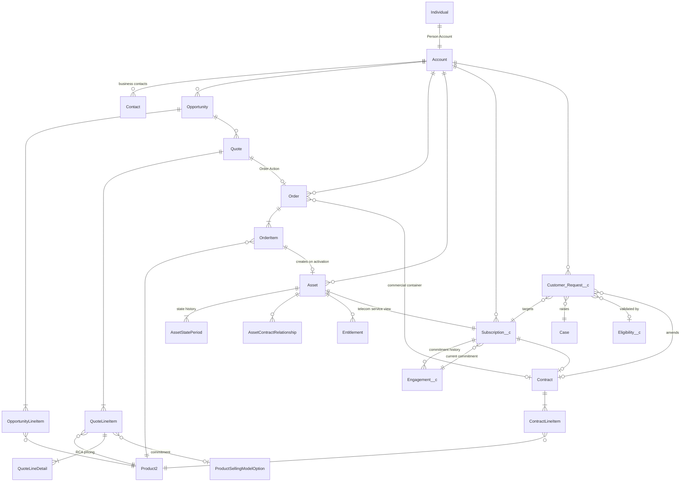

# ATS Telecom — Salesforce Technical Architecture

**Status:** Design approved, not implemented
**Target platform:** Salesforce · Revenue Cloud Advanced (RLM) + Experience Cloud
**Date:** 2026-09-29
**Author:** Solution Architecture

---

## 0. Decision Summary

| # | Decision | Outcome | Rationale |
|---|---|---|---|
| D1 | Quoting platform | **Revenue Cloud Advanced (RCA / RLM)** | Salesforce CPQ reached **end-of-sale in March 2025** — it cannot be licensed for a new project. RCA is the sanctioned successor and is built natively on core objects. See §3. |
| D2 | Target org | **Dedicated scratch org** (see §11) | Connected `devtospace-stage` is a shared sandbox with 134 foreign objects and ~250 foreign Apex classes |
| D3 | Object naming | **`Subscription__c`** (name is free in a dedicated org) | Avoids collision with an unrelated e-commerce object (§2.2) |
| D4 | Customer model | **Person Accounts (B2C)** | Telecon subscription is a consumer product; collapses the portal security model |
| D5 | Commercial container | **`Contract` + Sales Contract Line** (RCA) | Holds the 12/24-month term, groups plan + device under one commitment, carries adjustments |
| D6 | Commitment modelling | **`ProductSellingModelOption`**, not separate Products | One product, variant pricing (§6.2) |
| D7 | Activation automation | **Apex service**, orchestrated by Flow | Transaction spans 5+ objects plus a rollback-capable callout (§7.3) |

### Open decisions still required

| # | Question | Owner | Blocking |
|---|---|---|---|
| **Q1** | Is a plan change a **Contract amendment** or a **new contract**? | Finance + Sales Ops | Phase 1 — determines `ContractLineItem` strategy and revenue treatment |
| **Q2** | Target org type and licensing (RCA Growth vs Advanced) | Project sponsor | Phase 0 — Advanced adds Consumption, Usage and Product Configurator |
| **Q3** | Do invoices and revenue recognition live in Salesforce? | Finance | Phase 10 — determines whether Revenue Cloud Billing is in scope |
| **Q4** | Source system for fiber eligibility data | Network team | Phase 6 — determines integration pattern |

---

## 1. Scope

**In scope:** end-to-end design covering data model, product catalog and pricing, customer acquisition, the 360° advisor cockpit, the guided subscription journey, post-sale activation, the Experience Cloud self-service portal, and the subscription lifecycle (plan change and cancellation).

**Out of scope:** implementation, deployment, seed data, billing implementation (pending Q3).

---

## 2. Environment Baseline (Verified)

All findings below were read directly from the connected org. **Nothing here is assumed.**

### 2.1 Connection

| Property | Value |
|---|---|
| Alias | `devtospace-stage` |
| Instance | `devtospace--stage.sandbox.my.salesforce.com` |
| API version | 68.0 |
| Auth | OAuth, connected |

### 2.2 Critical Findings

| Finding | Evidence | Consequence |
|---|---|---|
| **CPQ not installed** | `Quote`, `QuoteLineItem`, `SBQQ__*` all absent from `EntityDefinition` | Quoting must be built on RCA, or hand-rolled (§3) |
| **RCA not installed** | `ProductClassification`, `ProductSellingModel`, `SalesTransactionType` absent | RCA must be enabled — **org-level, not deployable via CLI** |
| **`Subscription__c` is taken** | Label `Abonnement`; fields `Amount__c`, `Email__c`, `StartDate__c`, `Status__c`, `Subscription_Type__c`, `Accept_Notifications__c` | E-commerce/newsletter object consumed by the org's Stripe/Shopify code. **Must not be reused.** → D3 |
| `Engagement__c`, `Customer_Request__c`, `Eligibility__c` | Absent | Names are free |
| **Foreign metadata** | 134 custom objects; ~250 no-namespace Apex classes; 11 Experience Cloud sites | Namespace is mandatory |
| Installed packages | DevOps Center, Channel Orders, `sfcma` (Commerce), `KPIapp` | DevOps Center is available for CI/CD (§11) |
| Existing projects | Recruiting/ATS (`Candidat*`, `Candidature*`, `Mission*`), ads automation (TikTok/Snapchat/LinkedIn), Shopify/Stripe store | Confirms `devtospace-stage` is a **multi-project** sandbox |
| Org labels | French — `Account` = `Société`, `Contact` = `Contact Société` | Translation Workbench required (§11) |
| Local repository | Empty. No `sfdx-project.json`, no `force-app/`, no git history | `sf project init` from scratch |

### 2.3 Objects Confirmed Present and Usable

```
Account  Contact  Individual  Opportunity  OpportunityLineItem
Product2  Pricebook2  Case
Order  OrderItem  Asset  Entitlement  WorkOrder  ServiceAppointment
Contract  ContractLineItem  ServiceContract
ContactPointAddress  ContactPointPhone  PartyConsent
```

---

## 3. Platform Selection: Revenue Cloud Advanced

### 3.1 Why not Salesforce CPQ

**Salesforce CPQ reached end-of-sale in March 2025.** It is not end-of-life — existing customers may renew and expand — but it is **no longer sold to new customers** and receives **no new feature investment**. Since July 2026 its online documentation has been retired.

For a greenfield project this is decisive: **installing CPQ today means adopting a frozen product on day one and owning an unavoidable migration later.** Per Salesforce's own FY27 partner guidance, new quote-to-cash business is steered to Revenue Cloud.

| Dimension | Salesforce CPQ | Revenue Cloud Advanced |
|---|---|---|
| Architecture | Managed package (`SBQQ__*`) on top of Sales Cloud | Native to core Salesforce |
| Transaction objects | `SBQQ__Quote__c` etc. | Standard `Quote`, `Order`, `Contract` with Transaction Management fields |
| Quote UI | Source of truth | **One consumer of the API** — screens are replaceable |
| Subscription management | Subscription custom object | **Asset-based** amendments, renewals, cancellations |
| Revenue models | One-time, term subscription, limited consumption | One-time, subscription, consumption, hybrid |
| Composability | All-or-nothing bundle | Adopt catalog / pricing / quoting / billing independently |
| AI readiness | Limited | Built for Agentforce, APIs, headless |
| Commercial status | **End of sale** | Actively sold and developed |

### 3.2 What RCA changes in this design

Three consequences materially reshape the architecture:

1. **Asset-based subscription lifecycle.** RCA drives amendments, renewals and cancellations from `Asset`, not from a subscription object. This *aligns with* our model (§5.2) — the provisioned `Asset` becomes the revenue-managed record, and `Subscription__c` becomes the telecom-specific view layered on it. RCA's default and ours agree.

2. **API-first pricing and configuration.** Every core capability is available as a documented API before it is a screen. Therefore **the guided wizard calls the RCA pricing API server-side** — it does not reimplement pricing in LWC. This eliminates the single largest divergence risk between advisor and portal (Risk R4).

3. **Composable adoption.** Catalog, pricing, transaction management and billing are independent. Phases 1–9 of the build (§13) require **only** Product Catalog Management, Salesforce Pricing, and Transaction Management. Billing can be deferred pending Q3.

### 3.3 Required org configuration (not deployable via CLI)

These are Salesforce-setup actions, not metadata deployments. They must happen in Phase 0.

| Action | Notes |
|---|---|
| Enable **Revenue Cloud Advanced** | Contact the Salesforce account team; RCA is a paid SKU on Sales Cloud |
| Create **Pricing Admin** permission set / users | Salesforce notes a Pricing Admin **cannot** create or update `PricingRecipe` fields; that requires System Admin |
| Activate **decision tables and pricing procedures** | They are inert until activated |
| Enable **Product Configurator** *(optional)* | Constraint Modeling Language (CML) — required only if device/configuration constraints exceed declarative `ProductConfigurationRule` |
| Register **Named Credentials** and **External Services** | Required for the BSS and image APIs |

> **Deployment note:** Pricing recipes, decision tables and context definitions are **setup-time configuration**, not deployable metadata. They are built in the org UI, then **exported and stored in version control** as a build artifact. Plan a controlled export step in the release process — otherwise pricing becomes the one part of the release you cannot reproduce or roll back.

---

## 4. Target Architecture

```
┌───────────────────────────────────────────────────────────────────────┐
│  CHANNELS                                                             │
│  Advisor Console (Sales + Service)      │  ATS Portal (Experience)   │
├───────────────────────────────────────────────────────────────────────┤
│  EXPERIENCE                                                           │
│  lwc:customer360Shell · lwc:subscriptionWizard · Record Pages         │
│  Portal LWC (LDS, no Apex controllers)                                │
├───────────────────────────────────────────────────────────────────────┤
│  ORCHESTRATION (Salesforce Flow)                                       │
│  Lead conversion · Order activation · Plan change · Cancellation      │
│  Eligibility · Renewal outreach · Image sync                          │
├───────────────────────────────────────────────────────────────────────┤
│  DOMAIN SERVICES (Apex — stateless, bulk-safe, USER_MODE)             │
│  CatalogQueryService → RCA Pricing API                                │
│  OfferBuilderService   → RCA Configuration + Transaction API          │
│  ActivationService     → Order · Asset · Subscription · Engagement    │
│  EngagementPenaltyService · EligibilityService · ExternalApiService   │
│  LeadImportService     → Bulk API                                      │
├───────────────────────────────────────────────────────────────────────┤
│  TRIGGER LAYER — single write path per object                         │
│  Order · Asset · Subscription__c · Engagement__c · Customer_Request__c│
├───────────────────────────────────────────────────────────────────────┤
│  REVENUE CLOUD ADVANCED                                                │
│  Catalog (ProductClassification, ProductAttribute, ProductSellingModel)│
│  Pricing (PricingProcedure, DecisionTable, BundleBasedAdjustment)     │
│  Configurator (ProductConfigurationRule, ExpressionSetConstraintObj)  │
│  Transaction (Quote, Order, Contract, Asset)                          │
├───────────────────────────────────────────────────────────────────────┤
│  ATS DOMAIN                                                          │
│  Subscription__c · Engagement__c · Customer_Request__c                │
│  Eligibility__c · Integration_Log__c                                  │
│  Engagement_Penalty__mdt · External_Api__mdc · Product_Rule__mdt     │
├───────────────────────────────────────────────────────────────────────┤
│  INTEGRATION — BSS/OSS · Product Image API · Weather · Agentforce      │
└───────────────────────────────────────────────────────────────────────┘
```

**Governing rule:** every cross-object write passes through a domain service. Triggers and Flows never invoke each other. This is what makes the case study's "single source of truth" claim (§8) actually true rather than aspirational.

---

## 5. Data Model

### 5.1 Relationship Map



### 5.2 The Central Modelling Decision

The case study (§3) models subscriptions as a flat `Subscription__c` + `Engagement__c` pair. **This is the weakest part of the blueprint.** In telecoms, four lifecycles genuinely diverge, and collapsing them is the primary cause of data drift:

| Lifecycle | Object | Concern |
|---|---|---|
| **Commercial** | `Contract` + `ContractLineItem` | 12/24-month term, renewal, amendments, adjustments |
| **Provisioned** | `Asset` + `Entitlement` + `AssetStatePeriod` | What the customer actually has; drives FMW/OM and inventory |
| **Service instance** | `Subscription__c` | Telecom specifics: MSISDN, line status, suspension, porting |
| **Commitment** | `Engagement__c` | Penalties, early-termination fees, transfer |

**Why it matters operationally** — a single customer action touches a *different subset* of each:

| Customer action | Contract | Asset | Subscription | Engagement |
|---|---|---|---|---|
| Plan upgrade | Amend (rate change) | Unchanged | Supersede + create | Unchanged |
| Phone swap | Unchanged | Retire + create | Unchanged | Unchanged |
| Freeze / suspend | Unchanged | Unchanged | → `Suspended` | Unchanged |
| Cancellation | Terminate | → `Retired` | → `Cancelled` | → `Breached` (penalty) |

Under RCA this split is reinforced, not fought: RCA drives amendment, renewal and cancellation from the `Asset`, using `AssetStatePeriod` for history. Our model is aligned with the platform's own lifecycle model.

### 5.3 `Subscription__c` — Service Instance

One record per active line per service type.

| Field | Type | Notes |
|---|---|---|
| `Subscription_Number__c` | Text(30), **External ID, unique** | CRM ↔ BSS integration key |
| `Account__c` | Lookup(Account), **required** | Query root. Index it |
| `Contact__c` | Lookup(Contact) | Primary line holder; required only under B2B (D4) |
| `Product__c` | Lookup(Product2) | |
| `ProductClassification__c` | Lookup(ProductClassification) | RCA family — drives the 360° grouping |
| `Order_Product__c` | Lookup(OrderItem) | Commerce lineage |
| `Asset__c` | Lookup(Asset) | **1:1 — this is the linkage that makes RCA amendments work** |
| `Contract__c` | Lookup(Contract) | Commercial container |
| `Engagement__c` | Lookup(Engagement__c) | Current commitment only; history is self-relation |
| `Parent_Subscription__c` | Lookup(self) | Groups plan + device under one bundle |
| `Status__c` | Picklist (restricted) | `Draft / PendingActivation / Active / Suspended / PendingCancellation / Cancelled / Superseded` |
| `MSISDN__c` | Text(20) | External ID, unique when populated |
| `Line_Number__c` | Text(20) | Landline / fixed |
| `Activation_Date__c` | Date | Set by activation |
| `Termination_Date__c` | Date | |
| `Billing_Start_Date__c` / `Billing_End_Date__c` | Date | Denormalised from `Engagement__c` for list rendering |
| `Next_Renewal_Date__c` | **Formula** on `Billing_End_Date__c` | Drives the renewal queue |
| `External_Status__c` | Text(40) | Last status reported by BSS — read-only |
| `Last_Sync_DateTime__c` | DateTime | Integration health |

**Rules**
- `Status__c` is the **only** mutable lifecycle field. No other automation writes it.
- `Account__c` + `Status__c` external-ID for bulk sync.
- The 360° status badge is a computed pill on `Status__c` — never a stored boolean.
- `Parent_Subscription__c` avoids a separate bundle object: commercial grouping is already `Contract`; this exists only to render "plan + device" in one row.

### 5.4 `Engagement__c` — Commitment

| Field | Type | Notes |
|---|---|---|
| `Engagement_Number__c` | Text(30), External ID, unique | |
| `Account__c` | Lookup(Account) | |
| `Subscription__c` | Lookup(Subscription__c) | |
| `Contract__c` | Lookup(Contract) | **The term of record** |
| `Duration_Months__c` | Number(2) (restricted) | `12` / `24` — bound to `ProductSellingModelOption` |
| `Start_Date__c` / `End_Date__c` | Date | Computed at activation from `Activation_Date__c` |
| `Status__c` | Picklist (restricted) | `Pending / Active / Expired / Breached / Transferred` |
| `Early_Termination_Fee__c` | Currency(12,2) | Output of `EngagementPenaltyService` |
| `Penalty_Rule__mdt__c` | Lookup(Engagement_Penalty__mdt) | Which rule was applied — **auditability** |
| `Penalty_Calculated_On__c` | DateTime | |
| `Months_Remaining__c` | **Formula** | `MAX(0, DATEDIF(TODAY, End_Date__c, 'M'))` |
| `Renewal_Contacted__c` | Checkbox | Prevents duplicate renewal outreach |

> **Implementation note (2026-11-06):** the deployed Engagement reference is the
> auto-number `Name` field (`ENG-{0000}`). `Engagement_Number__c` is not deployed
> because it cannot be both an Auto Number and an External ID. If a true external
> ID is needed for Engagement upserts, add a separate Text(30) field.

**The anti-requirement:** `Months_Remaining__c` and any `Is_Committed__c` must be **formulas**, never stored fields. A stored commitment boolean drifts the moment a date changes — the single most common source of incorrect penalty quotes in telecoms.

### 5.5 `Customer_Request__c`

| Field | Type | Notes |
|---|---|---|
| `Request_Number__c` | Auto Number `REQ-{YYYY}-{0000}` | |
| `Request_Type__c` | Picklist (restricted) | `NewSubscription / PlanChange / Cancellation / EquipmentSwap / Suspension` |
| `Channel__c` | Picklist (restricted) | `Portal / Advisor / API / Batch` — enables portal-vs-advisor reporting |
| `Account__c` / `Contact__c` | Lookup | |
| `Subscription__c` | Lookup | Target line |
| `Case__c` | Lookup(Case), **required** | Delivers the case study's "full traceability" guarantee |
| `Requested_Product__c` | Lookup(Product2) | Target plan for a change |
| `Impacted_Engagement__c` | Lookup(Engagement__c) | Resolved at intake |
| `Status__c` | Picklist (restricted) | `Draft / Submitted / Eligibility_Checked / Fee_Quoted / Awaiting_Approval / Approved / In_Fulfilment / Completed / Rejected / Cancelled` |
| `Cancellation_Reason__c` | Picklist | **Conditionally required** — see below |
| `Cancellation_Effective_Date__c` | Date | |
| `Calculated_Fee__c` | Currency(12,2) | Server-computed only |
| `Fee_Breakdown__c` | Long Text Area (1000) | Human-readable justification — what support actually needs |
| `Eligibility__c` | Lookup(Eligibility__c) | Fibre only |
| `Priority__c` / `Due_Date__c` | Picklist / Date | SLA-driven; feeds Case escalation |

**Mandatory cancellation reason** — implement with a **validation rule**, not a single validation with field-level required:

```
AND(
  OR( ISPICKVAL(Request_Type__c, "Cancellation"),
      AND( CHANGED(Request_Type__c),
           ISPICKVAL(PRIORVALUE(Request_Type__c), "Cancellation") ) ),
  ISBLANK(Cancellation_Reason__c)
)
→ ERROR: Cancellation reason is mandatory.
```

A Flow can also enforce this, but a validation rule gives a hard, non-bypassable guarantee. Field-level **required must be off**, otherwise the field is demanded on non-cancellation requests.

### 5.6 `Eligibility__c` — Fibre Coverage

One record per serviceable geography unit.

| Field | Type | Notes |
|---|---|---|
| `Postal_Code__c` | Text(10), **required, unique** | Lookup key from wizard and portal |
| `Country__c` | Text(2) | ISO 3166-1 alpha-2 |
| `Region__c` | Text(80) | Province / département |
| `Geo_Hash__c` | Text(12) | Optional — point-in-area checks |
| `Fiber_Available__c` | Checkbox | |
| `Max_Downstream_Mbps__c` / `Max_Upstream_Mbps__c` | Number(6) | Drives the eligible-plan filter |
| `Technologies__c` | Multi-select Picklist | `FTTH / FTTC / DSL / Cable` |
| `Earliest_Activation_Date__c` | Date | Prevents promising what the network cannot deliver |
| `Service_Restrictions__c` | Long Text Area | |
| `Source_System__c` | Text(40) | Lineage if batch-loaded from network inventory |
| `Last_Updated__c` | DateTime | |

Resolution flow: postal code → `EligibilityService` → wizard filters fibre products where `Max_Downstream_Mbps__c >= product.Speed_Mbps__c`, and blocks selection where `Earliest_Activation_Date__c > today`.

### 5.7 `Integration_Log__c` — Added Beyond the Case Study

| Field | Type | Notes |
|---|---|---|
| `Correlation_Id__c` | Text(36) | UUID; ties a transaction chain together |
| `Direction__c` | Picklist | `Outbound / Inbound` |
| `System__c` | Picklist | `BSS / ProductImage / Weather / Other` |
| `Endpoint__c` | Text(255) | |
| `Status_Code__c` | Text(10) | |
| `Status__c` | Picklist | `Success / Failure / Retried / DeadLetter` |
| `Duration_Ms__c` | Number | |
| `Payload_Ref__c` | Long Text Area (32768) | Redacted; never log secrets |
| `Error_Message__c` | Text(255) | |

The case study asserts a "single source of truth for the whole company" (§8) but specifies no observability. Without this object, a failed provisioning callout is undiagnosable, and reconciliation against the BSS is manual.

---

## 6. Catalog & Pricing (Revenue Cloud Advanced)

### 6.1 Catalog Structure

Products are classified through RCA's attribute-based catalog rather than a flat `Product2.Family` hierarchy.

```
ProductClassification                    (family hierarchy — replaces Product2.Family)
├── Mobile Plan
│   ├── Product2: Mobile 5 GB       Data_GB__c=5,  Unlimited_Calls__c, Unlimited_SMS__c
│   ├── Product2: Mobile 20 GB      Data_GB__c=20
│   ├── Product2: Mobile 50 GB      Data_GB__c=50
│   └── Product2: Mobile 100 GB     Data_GB__c=100
├── Fiber & Landline
│   ├── Product2: Fiber 20 Mb       Speed_Mbps__c=20
│   └── Product2: Fiber 100 Mb      Speed_Mbps__c=100
└── Device
    ├── Product2: iPhone 15 Pro     Requires_Commitment__c = true
    ├── Product2: iPhone 13
    └── Product2: Samsung S22
```

**ATS custom fields on `Product2`**

| Field | Type | Purpose |
|---|---|---|
| `Plan_Type__c` | Picklist | `Mobile / Fiber / Landline` — wizard step 2 filter |
| `Data_GB__c` | Number(5) | |
| `Speed_Mbps__c` | Number(6) | Compared against `Eligibility__c.Max_Downstream_Mbps__c` |
| `Unlimited_Calls__c` | Checkbox | |
| `Unlimited_SMS__c` | Checkbox | |
| `Requires_Commitment__c` | Checkbox | Enforced by `ProductConfigurationRule` |
| `Device_Image_URL__c` | URL | Populated by the image sync (§9) |
| `Specs__c` | Long Text Area | Rendered in wizard step 4 |
| `Recurring__c` | Checkbox | Feeds `ProductSellingModel` assignment |

### 6.2 The Single Most Important Catalogue Decision

**Do not model commitment as separate products.**

> ❌ `Mobile 5 GB — 12 months`, `Mobile 5 GB — 24 months`, `Mobile 5 GB — no commitment`
> → three products; every bundle and pricing rule must be maintained three times; the wizard must reconcile product identity across variants; reporting fragments by product.

> ✅ One `Product2` (`Mobile 5 GB`) with three `ProductSellingModelOption` records.

**`ProductSellingModelOption` — the commitment variants**

| Option code | Label | Discount | Drives |
|---|---|---|---|
| `NOCOMMIT` | No commitment | 0% | No `Engagement__c` created |
| `COMMIT12` | 12-month commitment | −10% | `Engagement__c.Duration_Months__c = 12` |
| `COMMIT24` | 24-month commitment | −20% | `Engagement__c.Duration_Months__c = 24` |

This satisfies case study §4 — *"each offer is available with or without a commitment, at different prices"* — with one product, and the option codes become the binding bridge to `Engagement__c`.

> **Verify at design time:** confirm the exact `ProductSellingModelOption` field names in your RCA release. Salesforce renames fields between releases; validate against the [Revenue Management Developer Guide](https://developer.salesforce.com/docs/atlas.en-us.revenue_lifecycle_management_dev_guide.meta/) before writing Apex or Flow against them.

### 6.3 Business Rules → RCA Mechanism

| Case study rule (§4) | RCA mechanism | Rationale |
|---|---|---|
| Commitment with/without, different prices | `ProductSellingModel` + `ProductSellingModelOption` + `PricebookEntry` | One product, variant pricing |
| **30% discount on mobile phone when an eligible plan is purchased** | `ProductSellingModelOption` bundle on the plan + **`BundleBasedAdjustment`** | Declarative, advisor cannot bypass it |
| Some smartphones **require** a commitment | **`ProductConfigurationRule`** (inclusion/exclusion) | Prevents a device-only quote with no commitment |
| Attribute-driven behaviour (data volume, speed tier) | `ProductAttribute` + `ExpressionSet` | Admin-owned, no code |
| Complex selection logic beyond the above | **CML / `ExpressionSetConstraintObj`** (optional, Advanced SKU) | Constraint modelling language |
| Fibre plan requires an eligible geography | **Flow / `EligibilityService` guard** | Geography is a *customer* attribute, not a product attribute — it does not belong in the catalog |
| Discount conditional on plan category | **`AttributeBasedAdjustment`** + `AttributeBasedAdjustmentRule` | Commercial logic owned by admins, not developers |

### 6.4 Pricing Procedure

```
PricingProcedure: "ATS Offer Pricing"
├── Step 1 — List price          ← PricebookEntry
├── Step 2 — Commitment discount ← ProductSellingModelOption adjustment
├── Step 3 — Bundle discount     ← BundleBasedAdjustment  (30% device discount)
├── Step 4 — Loyalty adjustment  ← AttributeBasedAdjustment
└── Step 5 — Floor / guardrail   ← max discount, margin floor
```

Decision tables and procedures **must be activated** to take effect. Pricing is the highest-risk configuration surface in this project: an unactivated step silently produces wrong prices with no error.

### 6.5 Client Pricing — Architectural Rule

**Neither the wizard nor the portal may compute prices in LWC.**

All pricing is a **server-side call to the RCA Pricing API** from `CatalogQueryService`, returning an authoritative price breakdown. The LWC renders that breakdown read-only.

This is enabled by RCA's API-first design and eliminates Risk R4 entirely — portal and advisor cannot see different prices, because there is only one pricing implementation.

---

## 7. Automation Architecture

### 7.1 Decision Rule

> **Flow** — transaction touches a single object, needs no rollback, makes no callout.
> **Apex service** — transaction spans ≥2 dependent objects, must be bulk-safe, or makes a callout that must roll back on failure.
> **Flow orchestrates; Apex executes.** Flows invoke Apex. Never the reverse.

### 7.2 Allocation Matrix

| # | Trigger | Mechanism | Rationale |
|---|---|---|---|
| 1 | Bulk lead import (home-page LWC) | LWC → `LeadImportService` (Apex REST, Bulk API) | Flow cannot exceed DML row limits; inherently bulk |
| 2 | Portal contact form | Screen Flow → `Lead` (`New`) | Low volume; declarative validation |
| 3 | `Lead.Status = 'Ready'` | **Flow** → `Account` + `Contact` + `Opportunity` | 3 independent records, no rollback — exactly Flow's strength |
| 4 | Wizard step 5 — create quote | Flow → `OfferBuilderService` | RCA configuration + transaction API |
| 5 | "Validate the Order" action | **Flow** → `ActivationService` invocable | Flow provides the entry point and error surface; Apex guarantees atomicity |
| 6 | Activation internals | `ActivationService` (Apex) | 5+ objects + BSS callout, all-or-nothing (§7.3) |
| 7 | Fibre eligibility check | `EligibilityService` | Query + rule evaluation |
| 8 | Commitment penalty calculation | `EngagementPenaltyService` + `Engagement_Penalty__mdt` | Matrix logic; not expressible maintainably in Flow |
| 9 | Plan change submitted | **Flow orchestration** + `OfferBuilderService` | Branching and user tasks in Flow; real work in Apex |
| 10 | Cancellation submitted | **Flow** (enforce reason) + `EngagementPenaltyService` + terminate | Hybrid |
| 11 | Subscription / Asset / Engagement sync | **Trigger handlers** | Guarantees a single write path; Flow cannot intercept every DML path (API, data load, integration) |
| 12 | Renewal outreach (T−60/30/7) | Scheduled Flow | Pure scheduling |
| 13 | 360° status badge | **Formula field** | Must never be stored |
| 14 | Product image sync | Scheduled Flow → `ExternalApiService` | Cached batch sync (§9) |

### 7.3 `ActivationService` — The Critical Transaction

Case study §8 lists three effects. The real contract is larger.

```
ActivationService.activate(orderId):
  1. Validate     — Order status is Activatable; OrderItems exist; not already activated
  2. For each OrderItem:
       a. Upsert Asset                       (ExternalId = OrderItemId  → idempotent)
       b. Create Subscription__c             (Status = Active, Activation_Date__c = today)
       c. Create Engagement__c               (only if a commitment option is present)
       d. Bind Asset.Contract                (via AssetContractRelationship)
  3. Order.Status = Activated
  4. Create / amend Contract                (if not already created)
  5. Call BSS provisioning                  (callout — 'ON_ERROR_ROLLBACK')
  6. Persist BSS identifiers
  7. Publish Platform Event 'ats.service.activated.v1'   (AFTER commit, not inside)
  8. Schedule Confirmation_Notification
```

**Mandatory properties**

| Property | Implementation |
|---|---|
| **Idempotent** | Guarded by an `Activation_State__c` field plus the unique index on `Subscription_Number__c`. An advisor double-clicking must not create two subscriptions or double-bill. |
| **Atomic** | Single `Database.save(..., allOrNone: true)` with explicit rollback on callout failure. Partial activation is unacceptable. |
| **Bulk-capable** | A BSS batch may activate 500 orders. Apex limits are 100 SOQL / 150 DML / 10,000 CPU ms. Trigger handlers must never assume a single row. |
| **Idempotent callout** | Send an idempotency key (`Subscription_Number__c`) to the BSS. Retries must not duplicate provisioning. |
| **Outbox pattern** | The platform event is published *after* commit, so consumers never observe phantom state. |
| **Observable** | Every step writes to `Integration_Log__c` with a shared `Correlation_Id__c`. |

### 7.4 Mandatory State Machine

`Subscription__c.Status__c` transitions are enforced by a trigger with an explicit allowed-transition map. This prevents a data load, an integration, or a Flow from moving a record into an illegal state.

```
Draft ──► PendingActivation ──► Active ──► Suspended ──► Active
                                  │
                                  ├──► PendingCancellation ──► Cancelled
                                  └──► Superseded ──► (replacement points here)
```

`Cancelled` and `Superseded` are **terminal**. Records are never hard-deleted.

---

## 8. Experience Architecture

### 8.1 The 360° Advisor Cockpit

Case study §6 specifies a specific zoned visual design. Declarative `relatedList` components **cannot** reproduce it — no status pills, no per-row Subscribe/Unsubscribe actions, no external API card.

**`lwc:customer360Shell`** — composed container, four zones:

| Zone | Component | Data source |
|---|---|---|
| Customer Information | `lightning-record-field` set + `c-statusBadge` | Account fields + computed active-subscription count |
| Subscriptions | `lightning-datatable` | `Subscription__c` — status pill, plan, monthly price, **Unsubscribe** row action |
| Subscriptions & Hardware | `lightning-datatable` | `Asset` — device image, serial, colour, status |
| Interactions | `lightning-timeline` / OmniCards | Case, Opportunity, Quote, Order history |
| External API | `c-externalApiCard` | Weather service via `ExternalApiService` |

**Action buttons** in the Highlights panel:

- **Subscribe** → launches `lwc:subscriptionWizard`
- **Unsubscribe** → creates a `Customer_Request__c` of type `Cancellation`. It does **not** cancel directly.

Routing destructive action through a request record is what makes case study §10's traceability real. A direct cancel from the 360 view would bypass the mandatory cancellation reason, the penalty calculation, and the Case linkage.

**Governance:** this is the largest bespoke artefact in the project and the highest maintenance cost. Keep each zone in its own child component so the shell remains stable across changes.

### 8.2 The Guided Journey (Case Study §7)

**One component, five steps.** Five separate record pages would mean five layouts, five permission sets, and no resumable state.

```
lwc:subscriptionWizard
├── state: { step, accountId, contactId, offerType, productId,
│            sellingModelOptionId, deviceId, quoteId, priceBreakdown }
│
├── Step 1  Confirm information → Account/Contact, real-time write-back
├── Step 2  Offer type         → Mobile | Landline
├── Step 3  Select plan        → CatalogQueryService.getPlans(type, commitment)
├── Step 4  Add device         → CatalogQueryService.getDevices(); images from sync
└── Step 5  Confirm            → OfferBuilderService.createQuote()
                               → "Finish & Activate" → ActivationService
```

**Key technical points**

| Concern | Approach |
|---|---|
| Step 3 option-aware filtering | `CatalogQueryService` (Apex, `cacheable=true`) → **RCA Configuration API**. Product option resolution is not available declaratively to LWC. |
| Pricing | Server-side RCA Pricing API call. The LWC renders; it never computes (§6.5) |
| Step 1 real-time sync | `wire` + `updateRecord`, debounced via an `Is_Autosync__c` flag — not a save per keystroke |
| Step 4 device images | Read from the cached `Device_Image_URL__c`. **Never** a live callout per datatable row — that alone will breach governor limits. |
| Progress persistence | `Subscription_Wizard_State__c` holds wizard state so a dropped connection is recoverable. Advisor subscriptions run long; this is a real failure mode. |
| Eligibility | Step 3 filters fibre products against `Eligibility__c`; step 5 blocks if the earliest activation date is in the future |

### 8.3 Experience Cloud Portal

**Hard rule: no Apex controllers in the portal.** The shared org contains 20+ `*Controller` classes for community login and registration — that anti-pattern must not be inherited here.

| Concern | Approach |
|---|---|
| Data access | LDS wire adapters — FLS enforced by default |
| Write access | Apex with `WITH USER_MODE` DML. Never bare `insert`/`update` |
| Filtering | `WITH SECURITY_ENFORCED` + `AccountId` derived from the authenticated user. **Never** trust a client-supplied AccountId |
| Complex operations | Thin Apex REST service, explicit FLS checks |
| External APIs | Named Credential. A server secret must **never** reach a client-side component |
| Guest lead capture | Screen Flow with reCAPTCHA or a Flow-based rate limit |
| Pricing | Same server-side RCA Pricing API as the advisor console |

**Three portal experiences**

1. **My Subscriptions** — active plans and equipment, read-mostly
2. **Track My Requests** — quotes, orders and customer requests by status
3. **Submit a Request** — plan change and cancellation forms → `Customer_Request__c` + `Case` (case study §9)

**Under D4 (Person Accounts)** the portal user → `Contact` → `Account` path is direct, which makes the entire security model materially simpler. Under B2B you must additionally verify the requesting contact is entitled to act for the account.

---

## 9. Integration Architecture

| Integration | Direction | Mechanism | Notes |
|---|---|---|---|
| BSS/OSS provisioning | Salesforce → BSS | Named Credential + `@future(callout=true)` or Batch Apex | **The activation boundary** (§7.3). Rollback on failure |
| BSS status reconciliation | BSS → Salesforce | Scheduled Batch + Platform Cache | Writes `External_Status__c` only |
| Product image API | Salesforce → external | Scheduled Flow → `ExternalApiService` | Syncs to `Device_Image_URL__c` |
| Weather API (case study §6) | Salesforce → external | `ExternalApiService` + Platform Cache | Demonstrates the pattern without hardcoding a vendor |
| Service events | internal | **Platform Events** | Published after commit |
| Reporting / BI | outbound | Change Data Capture → Data Cloud / Power BI | CDC on the 4 custom objects + `Asset` |
| Marketing (case study §11) | Marketing Cloud | `Lead` + Journey Builder | Detail out of scope |

**`External_Api__mdc` (Custom Metadata Type)** — no URL or key is ever hardcoded in Apex.

| Field | Type | Notes |
|---|---|---|
| `DeveloperName` | Text | Unique key |
| `BaseUrl__c` | Url | |
| `AuthType__c` | Picklist | `None / NamedCredential / OAuth` |
| `NamedCredential__c` | Text | **References the credential by name; the secret never leaves the platform** |
| `Timeout_Ms__c` | Number | Default 10000 |
| `Cache_Ttl_Seconds__c` | Number | Default 3600 |
| `Is_Active__c` | Checkbox | Allows a dead API to be disabled without a deployment |

---

## 10. Security & Data Protection

**Permission sets — not profiles**

| Set | Grant |
|---|---|
| `ats_Advisor` | Read on the 5 custom objects; create/edit on `Customer_Request__c`; no delete |
| `ats_AdvisorManager` | + fee override and approval authority |
| `ats_ServiceAgent` | Read subscriptions and assets; create Case and Request; no pricing override |
| `ats_PortalUser` | Scoped read on own Account's subscriptions, assets, orders; create `Customer_Request__c` |
| `ats_IntegrationUser` | Named-credential callouts only; **no UI access** |
| `ats_OpsAdmin` | Scheduled Flow and Batch management; pricing procedure activation |
| `ats_PricingAdmin` | Pricing procedures and decision tables. **Cannot** modify `PricingRecipe` fields — System Admin only |

**Controls**

| Control | Implementation |
|---|---|
| CRUD/FLS on custom objects | **Not** enabled by default. Grant only the specific fields each set needs |
| Sharing — internal | Account-based, default internal |
| Sharing — portal | Account sharing + `WITH SECURITY_ENFORCED` on every query |
| DML safety | `WITH USER_MODE` on every DML statement; no manual `stripInaccessible` needed |
| PII | Billing address, identity documents, payment data → restricted fieldsets. **Never** logged |
| Audit | Field History Tracking on `Status__c`, `Calculated_Fee__c`, `Cancellation_Reason__c` |
| Deletion | **Soft delete** only, via `Status__c`. Never `delete` a financial record |
| Sharing rules | Deliberately **omitted**. Sharing rules on `Subscription__c` are a data-leak vector behind a custom portal |

**Threat model**

| Threat | Mitigation |
|---|---|
| **IDOR on the portal** — a customer changes the AccountId in a request | Derive `AccountId` server-side from the authenticated user. Never accept it as input. Test explicitly (§12) |
| **Fee tampering** on a plan change | Fee computed server-side in `EngagementPenaltyService`. The client value is display-only |
| **Illegal state transition** via API or data load | Restrict `Status__c` value set per permission set; enforce transitions in the §7.4 trigger |
| **Mass assignment** | `Security.stripInaccessible` on any externally-supplied field map |
| **Double activation** | Idempotency guard + External ID + explicit test (§12) |
| **Pricing manipulation** | Pricing is server-side only (§6.5); the client never supplies a price |

---

## 11. Environments, Deployment & CI/CD

### 11.1 Environment Strategy

`devtospace-stage` is a **shared** sandbox holding three unrelated projects. It is not a suitable target for telecom work.

| Environment | Purpose | Refresh | Source of truth |
|---|---|---|---|
| `ats-dev` | Developer scratch | Ephemeral, on demand | Git |
| `ats-int` | Integration & SIT | Nightly | Git + pricing export |
| `ats-uat` | Business acceptance | Release train | Git + pricing export |
| `ats-prod` | Production | — | Git + pricing export |

### 11.2 CI/CD

**DevOps Center is already installed in the org — use it.** It provides work items, component-based deployment, and release management with no pipeline code to own.

Fallback: `sfdx-project.json` with split package directories plus GitHub Actions running `sf project deploy validate` → `deploy` → `run tests`.

### 11.3 Package Directory Split

```
force-app/        production metadata
force-app-test/   test classes, test data templates
manifest/         package.xml for ad-hoc deploys
scripts/          data seed (idempotent), post-deploy hooks
pricing-export/   RCA decision tables + pricing procedures, exported artefacts
```

**`pricing-export/` is mandatory, not optional.** Decision tables, pricing procedures, recipes and context definitions are setup-time configuration rather than deployable metadata. Without a controlled export step, pricing is the one part of the release you cannot reproduce, diff, or roll back.

### 11.4 Deployment Order

Declarative dependencies resolve in this order. Violating it fails the deploy.

```
CustomObject → CustomField → ValidationRule → CompactLayout
             → Flow → Apex class → LWC → FlexiPage → PermissionSet → CustomTab
```

Deploying an LWC before its Apex dependency fails. DevOps Center handles ordering; without it, sequence manually.

### 11.5 Data Seeding

No migration — this is greenfield. Seed data must be **idempotent**: use `sf data upsert` with External ID, never `insert`. Re-running a seed must not duplicate the catalogue.

### 11.6 Translation

Org labels are French (`Société`, `Contact Société`). Apply Translation Workbench to the 4 custom objects and the wizard. Decide deliberately which **standard** objects are translated — translating standard objects is a common source of layout and validation-rule conflicts across releases.

---

## 12. Testing Strategy

| Layer | Tool | Target |
|---|---|---|
| Apex unit | `@TestSetup`, `System.runAs`, `SeeAllData=false` | **≥75% org coverage, ≥80% on domain services** |
| Bulk safety | Test activating 200 `OrderItem`s | Proves §7.3 |
| Idempotency | Call `activate()` twice; assert exactly one subscription | Proves the double-click guard |
| Flow | Flow tests in a scratch org | Every status transition in §7.4 |
| Security | Run as `ats_PortalUser`; assert other accounts invisible | IDOR regression |
| FLS | Run as a restricted set; assert field-level denial | Regression against leaks |
| LWC | `@salesforce/sfdx-lwc-jest` | Component logic only — no Apex in jest |
| Pricing | Script a configure-price-quote sequence and assert returned numbers | **Highest value test in the project** |
| Integration | `HttpCalloutMock` or a mock Named Credential endpoint | Every callout path, including failure |
| E2E | Selenium / Playwright | The wizard and both portal request types |

**Mandatory non-functional tests**

| Test | Asserts |
|---|---|
| `activate()` on an order with no `OrderItem`s | Error surfaced, not silent success |
| Penalty calc on an engagement with `End_Date__c` in the past | Zero fee |
| Portal user querying another user's AccountId | Zero rows returned |
| `EngagementPenaltyService` with a missing `Engagement_Penalty__mdt` row | Default rule applied, not an exception |
| Pricing procedure run twice after a catalogue change | Identical results (proves decision-table refresh discipline) |
| BSS callout returning 500 | Full rollback; order remains `Activatable` |

> **On pricing test coverage:** with RCA being API-first, the pricing engine can be exercised without a UI. Script the full configure-price-quote sequence and assert the numbers on every deployment. This is precisely the discipline CPQ made difficult and it is the cheapest insurance in the project — a pricing defect ships on Friday and is discovered by Finance on Monday.

---

## 13. Build Sequence

| Phase | Deliverable | Exit gate |
|---|---|---|
| **0** Foundation | `sf project init`, dedicated org, RCA enabled, `ats_` scaffolding, permission sets, CI pipeline | Metadata deploys cleanly to an empty org |
| **1** Data model | 5 custom objects, fields, validation rules, `Engagement_Penalty__mdt`, `External_Api__mdc`, `Integration_Log__c` | Deploy succeeds; seeds load idempotently |
| **2** Catalog & pricing | `ProductClassification`, `ProductAttribute`, `ProductSellingModel` + options, `BundleBasedAdjustment`, pricing procedure | A committed 5 GB plan prices correctly with and without commitment; 30% device discount fires |
| **3** Acquisition | `LeadImportService`, home-page LWC, portal form, conversion Flow | Lead `Ready` → Account + Contact + Opportunity, idempotently |
| **4** Commerce | `OfferBuilderService`, `ActivationService`, activation Flow + custom action | Quote → Order → activate → Asset + Subscription + Engagement, atomically, and safely twice |
| **5** Advisor UX | `customer360Shell`, `subscriptionWizard`, `CatalogQueryService` | 5-step journey completes end-to-end from a blank Account |
| **6** Lifecycle | `EngagementPenaltyService`, plan-change and cancellation Flows, `Fee_Breakdown__c` | Both paths produce correct fees |
| **7** Portal | Site, 3 experiences, request forms, security layer | Customer cancels; advisor sees it in the 360 view |
| **8** Integration | BSS callout, `Integration_Log__c`, platform events, image sync | Rollback verified against a deliberately failing endpoint |
| **9** Hardening | Test suite to target, FLS/IDOR review, translation, performance | All exit criteria met |
| **10** *(conditional)* | Revenue Cloud Billing, if Q3 confirms Salesforce-owned invoicing | Invoicing and revenue recognition reconciled |

**Phases 1–2 are the critical path.** The data model and the catalogue are the two things that are expensive to change later. Everything else is iterative.

---

## 14. Risk Register

| # | Risk | Impact | Mitigation |
|---|---|---|---|
| **R1** | **RCA licensing is not yet secured** | The entire commerce spine (phases 2, 4, 5) is blocked | Resolve Q2 in phase 0. This is the largest schedule risk in the project |
| **R2** | **Pricing configuration is not deployable metadata** | Pricing changes bypass source control; no diff, no rollback | `pricing-export/` + activation discipline in the release runbook (§11.3) |
| **R3** | **Plan-change semantics undecided (Q1)** | Wrong choice forces full historical repricing and breaks revenue reporting | Decide with Finance before phase 1. Default: **amend** with `ContractLineItem` adjustment |
| **R4** | **RCA object/field names differ from the design** | Apex, Flow and queries fail at build time | Validate against the Revenue Management Developer Guide in phase 0; re-verify at each release |
| **R5** | **`Subscription__c` collision** in `devtospace-stage` | Build into the wrong org and the name is unavailable; reuse corrupts e-commerce data | D2/D3. Namespaced + prefixed naming as insurance |
| **R6** | **Shared sandbox coupling** | Foreign flows and triggers fire on ATS objects; `sfdx-scanner` reports mass violations | Dedicated org. If forced to share, audit existing automation coverage of the new objects first |
| **R7** | **Portal IDOR** | Customers see other customers' subscriptions — a reportable breach | Derive Account server-side; explicit test in §12 |
| **R8** | **Non-idempotent activation** | Duplicate subscriptions and double billing from a double-clicked button | Idempotency guard + External ID + dedicated test |
| **R9** | **Governor limit breach** in `ActivationService` | Batch activation fails in production only | 200-row bulk test in phase 4 |
| **R10** | **BSS callout inside the activation transaction** | Provisioning succeeds but Salesforce fails, or vice versa → orphan records | Outbox pattern + `Integration_Log__c` + reconciliation scheduled job |
| **R11** | **Stored lifecycle booleans** (`Is_Committed__c`) | Date changes silently invalidate commitment logic → wrong fees → wrong revenue | Formulas only. Enforce in code review (§5.4) |
| **R12** | **B2C/B2B confusion (D4)** | Reworking the customer model is a large migration | Decide before phase 1 |
| **R13** | **Decision tables not activated** | Pricing silently produces wrong values with no error | Activation is an explicit step in the release runbook |
| **R14** | **RCA expertise scarcity** | RLM is a new product; few consultants have delivered it | Budget SI support; start with one product family end-to-end as a learning spike |
| **R15** | **Single large LWC** (`customer360Shell`) | Becomes unmaintainable | Child component per zone; jest tests per child |
| **R16** | **French org labels** | Metadata deploys with label mismatches; user confusion on standard objects | Translation Workbench; decide translation scope in phase 1 |
| **R17** | **No billing or revenue model** | "Subscribed customer" remains a status flag with no financial truth | Phase 10, conditional on Q3 |

---

## 15. Anti-Patterns to Avoid

| Anti-pattern | Why it fails | Do instead |
|---|---|---|
| Commitment as separate `Product2` records | Catalogue triples; bundle rules unmaintainable | `ProductSellingModelOption` variants |
| Pricing computed in LWC | Portal and advisor diverge; client is untrusted | Server-side RCA Pricing API only |
| Hardcoded API URLs or keys in Apex | Leaks secrets; no environment separation | `External_Api__mdc` + Named Credential |
| `End_Date__c` written by two automations | Silent overwrite | One write path per object |
| Flow **and** trigger on one object | Undefined execution order | Triggers for interception, Flow for orchestration |
| "Finish & Activate" without idempotency | Duplicate subscription, duplicate billing | External ID + state guard |
| Apex without `WITH USER_MODE` | FLS bypass | `WITH USER_MODE` on all DML |
| Portal Apex controller classes | Bypasses FLS; unmaintainable | LDS + thin secured services |
| `delete` on subscriptions | Destroys financial history | Soft-close via `Status__c` |
| Stored `Is_Committed__c` / `Months_Remaining__c` | Drifts when a date changes | Formula fields |
| `insert` in seed scripts | Duplicates on re-run | `upsert` with External ID |
| Five record pages for the wizard | No resumable state; five layouts to maintain | One component, persisted state |
| Modifying `PricebookEntry` without refreshing decision tables | Pricing silently stale | Refresh in the release runbook |
| Native fields repurposed as scratch space | Blocks future standard features | Custom fields |

---

## 16. Case Study Traceability

| Case study § | Covered by | Notes |
|---|---|---|
| 1. Modernize to grow | — | Business objectives |
| 2. Unified advisor cockpit | §8.1 | `lwc:customer360Shell` |
| 3. Hybrid data model | §5 | **Restructured** — `Contract` + `Asset` + `Subscription__c` + `Engagement__c` |
| 4. Product catalog and rules | §6 | **Restructured** — commitment as `ProductSellingModelOption`; rules as `BundleBasedAdjustment` / `ProductConfigurationRule` |
| 5. Digitalize acquisition | §7.2 #1–3 | Bulk import LWC, portal form, conversion Flow |
| 6. 360° customer view | §8.1 | |
| 7. Five-step guided journey | §8.2 | One component, persisted state |
| 8. Quote to active service | §7.2 #4–6, §7.3 | **Hardened** — atomic, idempotent, bulk-safe, observable |
| 9. Experience Cloud portal | §8.3 | |
| 10. Plan change and cancellation | §7.2 #8–10, §5.5 | Conditional requirement via validation rule |
| 11. Unified platform | §4 | |
| 12. Best practices | §10, §11, §12 | |

### Deliberate divergences from the case study

Each is a correction of the blueprint, not a deviation from it.

| # | Case study | This design | Why |
|---|---|---|---|
| 1 | `Subscription__c` + `Engagement__c` as a flat pair | Four distinct lifecycles across `Contract`, `Asset`, `Subscription__c`, `Engagement__c` | The lifecycles diverge in practice (§5.2) |
| 2 | Commitment as distinct product variants | `ProductSellingModelOption` | One product; unmaintainable otherwise |
| 3 | Activation via Flow | Flow → `ActivationService` (Apex) | The transaction spans 5+ objects plus a rollback-capable callout |
| 4 | — | `Integration_Log__c` added | The case study asserts a single source of truth but specifies no observability |
| 5 | — | State machine on `Subscription__c.Status__c` | Prevents illegal transitions from any DML path |
| 6 | — | Mandatory cancellation reason via validation rule | Field-level required would demand it on non-cancellation requests |
| 7 | "Flow (or Apex)" | A per-trigger decision rule (§7.1) | The choice is determined by transactionality, not preference |

---

## 17. Definition of Done

- [ ] Metadata deploys cleanly to an empty org via CI
- [ ] All domain services at ≥80% test coverage; org at ≥75%
- [ ] The five-step journey completes end-to-end from a blank Account
- [ ] Both portal request types (plan change, cancellation) pass E2E
- [ ] A 200-order batch activates within governor limits
- [ ] A deliberately failing BSS endpoint produces a complete rollback
- [ ] A portal user cannot read another account's subscriptions
- [ ] A committed 5 GB plan prices correctly with and without commitment
- [ ] The 30% bundle discount applies to a device and is advisor-bypass-proof
- [ ] Pricing configuration is reproducible from version control and rollable back
- [ ] Every cross-object write is traceable through `Integration_Log__c`

---

## 18. References

| Topic | Source |
|---|---|
| CPQ end-of-sale, RCA positioning | [Salesforce — CPQ End of Life](https://www.salesforce.com/sales/cpq/end-of-life/) |
| Product Catalog, Pricing, Transaction and Asset objects | [Revenue Management Developer Guide](https://developer.salesforce.com/docs/atlas.en-us.revenue_lifecycle_management_dev_guide.meta/revenue_lifecycle_management_dev_guide/) |
| Data Model Gallery — Transaction Management | [Order](https://developer.salesforce.com/docs/platform/data-models/guide/transaction-mgmt-order.html) · [Salesforce Pricing](https://developer.salesforce.com/docs/platform/data-models/guide/salesforce-pricing.html) |
| Contracts data model | [Salesforce Contracts](https://developer.salesforce.com/docs/platform/data-models/guide/salesforce-contracts.html) |
| Product Configurator / CML | [Product Configurator](https://developer.salesforce.com/docs/atlas.en-us.revenue_lifecycle_management_dev_guide.meta/revenue_lifecycle_management_dev_guide/prod_config_overview.htm) |
