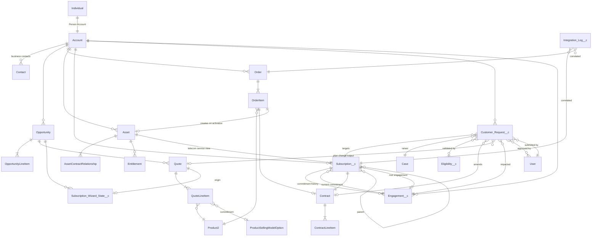

# ATS Telecom — Data Model Specification

**Status:** Design specification, not implemented
**Companion document:** [`ARCHITECTURE.md`](./ARCHITECTURE.md) §5
**Date:** 2026-09-29
**Namespace prefix:** `ats_` (applies to namespaced metadata types only)

---

## 0. Purpose and Scope

This document specifies **every data structure** required to deliver the ATS Telecom case study, at a level of field-level precision that a developer could build from without re-deriving the design.

**In scope:** object inventory, complete field dictionaries, custom metadata types, validation rules, formulas, indexes, field-level security, retention policy, and seed catalogue.

**Out of scope:** Apex, Flow, LWC, and configuration logic — those are specified in [`ARCHITECTURE.md`](./ARCHITECTURE.md) §7–§8. This document is the **data** contract those components bind to.

### Conventions used in this document

| Convention | Rule |
|---|---|
| Custom object | `PascalCase__c` |
| Custom field | `Pascal_Case__c` |
| Relationship field | `Relationship_Name__c` (relationship name strips `__c`) |
| Autonumber display | `PREFIX-{0000}` |
| Currency | `Currency(12,2)` |
| Percent | `Percent(5,2)` unless stated |
| "Required" | `Required` at the field level **and** present in the relevant permission set |
| "R" | RCA dependency — cannot be deployed until Revenue Cloud Advanced is enabled |

---

## 1. Object Inventory

### 1.1 Summary

| Category | Count | Notes |
|---|---|---|
| Custom objects created by ATS | 6 | 4 business + 1 technical + 1 UI state |
| Standard objects extended | 14 | Custom fields, validation, layout |
| Revenue Cloud objects referenced | 3 | Post-RCA-install dependencies |
| Custom metadata types | 2 | Deliberately minimal — see §9.2 |
| Custom settings | 1 | Feature flags |
| Custom permissions | 4 | Flow gates |
| Custom labels | 12 | UI microcopy, FR/EN |
| Global value sets | 3 | Reused picklist value sets |

### 1.2 Custom Objects

| Object | Label | Purpose | Records |
|---|---|---|---|
| `Subscription__c` | Subscription | Telecom service instance per line | High volume — millions |
| `Engagement__c` | Engagement | Commitment period (12/24 months) + penalties | High volume |
| `Customer_Request__c` | Customer Request | Plan change, cancellation, equipment requests | Medium |
| `Eligibility__c` | Fiber Eligibility | Geographic serviceability lookup | Low — one per postcode |
| `Integration_Log__c` | Integration Log | Callout audit trail | High volume — retires at 13 months |
| `Subscription_Wizard_State__c` | Subscription Wizard State | Resumable guided-journey state | Low — one active per advisor |

### 1.3 Standard Objects Extended

| Object | Extensions |
|---|---|
| `Account` | Segment, status, legacy ID, consent, language |
| `Contact` | DNC flag, preferred contact method |
| `Lead` | Source detail, consent, dedupe flag |
| `Opportunity` | Journey step, eligibility checked, primary contact |
| `Product2` | Plan attributes, image, product code, recurring flag |
| `Pricebook2` | Active flag, effective dating |
| `Quote` (R) | Wizard session link, portal flag |
| `QuoteLineItem` (R) | Commitment option snapshot |
| `Order` (R) | Activation state, activation audit, BSS key |
| `OrderItem` (R) | Subscription number, asset creation flag |
| `Asset` (R) | Service line type, primary line flag, provisioning status |
| `Contract` (R) | ATS contract type, signature date, auto-renew |
| `ContractLineItem` (R) | Engagement link |
| `Case` | Request link, subscription link, channel |

### 1.4 Revenue Cloud Objects Referenced (Post-Install)

| Object | Use | Deployment dependency |
|---|---|---|
| `ProductClassification` | Product family hierarchy, replaces `Product2.Family` | Lookup fields cannot deploy until RCA is enabled |
| `ProductSellingModelOption` | Commitment variants (§6.2 of ARCHITECTURE.md) | Referenced by wizard state and quote line |
| `SalesTransactionType` | Quote/Order transaction type | Referenced by integration config only |

> **Deployment consequence:** three lookups in §5 depend on RCA objects. If RCA is enabled in phase 0 this is a non-issue. If it is not, those three fields must be split into a later deployment increment rather than removed — removing them later would lose data.

---

## 2. Relationship Model



### 2.1 Cardinality Decisions

| Relationship | Type | Reason |
|---|---|---|
| `Subscription__c → Account__c` | **Lookup** (not Master-Detail) | Account deletion must not cascade-delete financial records |
| `Subscription__c ↔ Asset__c` | **1:1, `Asset__c` is the parent of truth** | RCA drives amendments from `Asset`. `Subscription__c` mirrors it |
| `Subscription__c → Engagement__c` | **Lookup to current + child history** | One active engagement at a time, many historical. Avoids a circular dependency |
| `Subscription__c → Subscription__c` | **Self-lookup, `Parent_Subscription__c`** | Renders "plan + device" in one row without a bundle object (§2.2) |
| `Engagement__c → Contract__c` | **Lookup** | RCA owns contracts; we reference, never write directly |
| `Customer_Request__c → Case__c` | **Lookup, required** | Enforces the case study's "full traceability" guarantee |

### 2.2 Why No `Bundle__c` Object

A bundle grouping (mobile plan + device under one commitment) is **already expressed twice**:

1. **Commercially** — by `Contract` and its `ContractLineItem` records. RCA already understands multi-line commitments.
2. **For display** — by `Subscription__c.Parent_Subscription__c`.

A third object would be a duplicate representation with no owner, guaranteeing drift. Add one only if a bundle later needs fields of its own (bundle-level discount, bundle-level eligibility, bundle-level status).

---

## 3. `Subscription__c` — Service Instance

> One record per active line per service type. This is the **high-volume** object — design for scale, not richness.

### 3.1 Standard Fields

| Field | Type | Configuration |
|---|---|---|
| `Name` | Auto Number | Display format `SUB-{0000}` — indexable, sortable, unique |
| `CreatedById` / `LastModifiedById` | Standard | Retain — primary audit trail |
| `OwnerId` | Lookup(User) | The **account owner**, not the transaction owner. Routing follows the customer, not the action |

### 3.2 Field Dictionary

| Field API Name | Label | Type | Required | Unique | Ext. ID | Notes |
|---|---|---|---|---|---|---|
| `Subscription_Number__c` | Subscription Number | Auto Number | ✔ | ✔ | — | `SUB-{0000}`. Human reference |
| `External_Reference__c` | External Reference | Text(64) | — | ✔ | ✔ | **CRM ↔ BSS key.** Set by `ActivationService` from the BSS response |
| `Account__c` | Account | Lookup(Account) | ✔ | — | — | **Query root. Index it** |
| `Contact__c` | Primary Contact | Lookup(Contact) | — | — | — | Required only under B2B |
| `Product__c` | Product | Lookup(Product2) | ✔ | — | — | |
| `ProductClassification__c` | Product Family | Lookup(ProductClassification) | — | — | — | **R** — drives 360° grouping |
| `Order_Product__c` | Order Product | Lookup(OrderItem) | — | — | — | Commerce lineage |
| `Asset__c` | Asset | Lookup(Asset) | ✔ | — | — | **1:1.** Linkage that makes RCA amendments resolve to the ATS record |
| `Contract__c` | Contract | Lookup(Contract) | — | — | — | Commercial container |
| `Engagement__c` | Current Engagement | Lookup(Engagement__c) | — | — | — | The **active** commitment only. History is the child relationship |
| `Root_Engagement__c` | Root Engagement | Lookup(Engagement__c) | — | — | — | Shared commitment when plan + device are bundled. Drives penalty once, not twice |
| `Parent_Subscription__c` | Parent Subscription | Lookup(`Subscription__c`) | — | — | — | Self-lookup. Display grouping only |
| `Status__c` | Status | Picklist (restricted) | ✔ | — | — | §3.3 |
| `Service_Line_Type__c` | Service Line Type | Picklist (restricted) | ✔ | — | — | `Mobile / Fiber / Landline / Device` — the 360° "Subscriptions" vs "Hardware" split |
| `MSISDN__c` | Mobile Number (MSISDN) | Text(20) | — | ✔* | ✔ | *Unique **when populated**. Enforce with a Validation Rule (§11.2) |
| `Line_Number__c` | Line Number | Text(20) | — | — | — | Fixed line / landline |
| `Activation_Date__c` | Activation Date | Date | — | — | — | Set by `ActivationService` |
| `Termination_Date__c` | Termination Date | Date | — | — | — | Soft-close date |
| `Billing_Start_Date__c` | Billing Start Date | Date | — | — | — | Denormalised from `Engagement__c` for list rendering |
| `Billing_End_Date__c` | Billing End Date | Date | — | — | — | Denormalised. See §12 — *snapshot, do not recompute* |
| `Next_Renewal_Date__c` | Next Renewal Date | **Formula**, Date(4,0) | — | — | — | `Billing_End_Date__c` |
| `Monthly_Amount__c` | Monthly Amount | Currency(12,2) | — | — | — | Snapshot at activation. Feeds the 360° price column without a pricebook join |
| `External_Status__c` | External Status | Text(40) | — | — | — | Last status reported by BSS — read-only |
| `Last_Sync_DateTime__c` | Last Sync | DateTime | — | — | — | Integration health indicator |
| `Display_Name__c` | Display Name | **Formula**, Text(255) | — | — | — | §3.4 |
| `Is_Committed__c` | Is Committed | **Formula**, Checkbox | — | — | — | §3.5 — **deliberately a formula, never stored** |

### 3.3 `Status__c` Value Set

| API Value | Label | Colour | Terminal |
|---|---|---|---|
| `Draft` | Draft | Grey | No |
| `PendingActivation` | Pending Activation | Blue | No |
| `Active` | Active | **Green** | No |
| `Suspended` | Suspended | **Yellow** | No |
| `PendingCancellation` | Pending Cancellation | Orange | No |
| `Cancelled` | Cancelled | **Red** | **Yes** |
| `Superseded` | Superseded | Grey | **Yes** |

**This picklist must be a Global Value Set** (`GlobalValueSet: ATS_Subscription_Status`) — the same values recur in `Asset.Provisioned_Status__c` and the wizard.

**Allowed transitions** — enforced by `SubscriptionTriggerHandler` (ARCHITECTURE.md §7.4):

```
Draft → PendingActivation → Active ⇄ Suspended
                            ├──→ PendingCancellation → Cancelled
                            └──→ Superseded           (terminal)
```

### 3.4 `Display_Name__c` Formula

```
TEXT(Product__r.Name)
  & IF(ISBLANK(MSISDN__c), "", " · " & MSISDN__c)
  & IF(ISBLANK(Line_Number__c), "", " · " & Line_Number__c)
```

### 3.5 `Is_Committed__c` Formula — The Anti-Requirement

```
AND(
  ISNEW() = FALSE,
  NOT(ISBLANK(Engagement__c)),
  Engagement__r.Status__c = 'Active',
  Engagement__r.End_Date__c > TODAY()
)
```

**Never store this as a checkbox.** A stored `Is_Committed__c` drifts the instant a date changes, and commitment status drives penalty calculation and renewal outreach. This is the single most common source of incorrect fees in telecoms implementations. See ARCHITECTURE.md risk R11.

### 3.6 Scale Considerations

| Consideration | Mitigation |
|---|---|
| Millions of records | `Account__c` + `Status__c` compound index (§13) |
| Formula fields on high-volume objects | `Display_Name__c` and `Is_Committed__c` reference only indexed fields |
| Cross-object formulas | `Is_Committed__c` traverses a relationship — **do not** add more than one such formula to this object; each is a join at query time |
| `Asset__c` uniqueness | 1:1 enforced by trigger; there is no declarative unique field across objects |

---

## 4. `Engagement__c` — Commitment

> A commitment period with a penalty. The **term of record** is `Contract__c`; this object carries the ATS-specific penalty and audit layer.

### 4.1 Standard Fields

| Field | Type | Configuration |
|---|---|---|
| `Name` | Auto Number | `ENG-{0000}` |
| `OwnerId` | Lookup(User) | Account owner |

### 4.2 Field Dictionary

| Field API Name | Label | Type | Required | Unique | Notes |
|---|---|---|---|---|---|
| `Engagement_Number__c` | Engagement Number | Auto Number | ✔ | ✔ | `ENG-{0000}` |
| `Account__c` | Account | Lookup(Account) | ✔ | — | Denormalised for security rules and fast queries |
| `Subscription__c` | Subscription | Lookup(`Subscription__c`) | ✔ | — | The line this commitment is attached to |
| `Root_Engagement__c` | Root Engagement | Lookup(self) | — | — | Self-lookup. Groups plan + device under one commitment |
| `Contract__c` | Contract | Lookup(Contract) | — | — | **The term of record** |
| `Asset__c` | Asset | Lookup(Asset) | — | — | Lets RCA resolve an amendment to the ATS engagement |
| `Duration_Months__c` | Duration (Months) | Number(2,0), restricted `12 / 24` | ✔ | — | Bound to the `ProductSellingModelOption` code |
| `Start_Date__c` | Start Date | Date | ✔ | — | = `Subscription__c.Activation_Date__c` |
| `End_Date__c` | End Date | Date | ✔ | — | **Settable** — early termination shortens it |
| `Planned_End_Date__c` | Planned End Date | **Formula**, Date(4,0) | — | — | `EDATE(Start_Date__c, Duration_Months__c)` — the *inception* term, immune to early termination |
| `Status__c` | Status | Picklist (restricted) | ✔ | — | §4.3 |
| `Monthly_Amount__c` | Monthly Amount | Currency(12,2) | — | — | **Snapshot at inception.** A later plan price change must not retroactively alter a penalty |
| `Penalty_Rate__c` | Penalty Rate | Percent(5,2) | — | — | **Snapshot** of the rule applied. Makes the fee reproducible years later |
| `Early_Termination_Fee__c` | Early Termination Fee | Currency(12,2) | — | — | Output of `EngagementPenaltyService` |
| `Penalty_Rule__c` | Penalty Rule | Lookup(`Engagement_Penalty__mdt`) | — | — | Which rule was applied — **auditability** |
| `Penalty_Calculated_On__c` | Penalty Calculated On | DateTime | — | — | Stamped when the fee was computed |
| `Penalty_Breakdown__c` | Penalty Breakdown | Long Text Area(1000) | — | — | Human-readable justification — what support actually needs to read |
| `Breach_Amount__c` | Breach Amount | Currency(12,2) | — | — | Charged amount, may differ from calculated (goodwill waiver) |
| `Goodwill_Waiver__c` | Goodwill Waiver | Checkbox | — | — | Explains `Breach_Amount__c` ≠ `Early_Termination_Fee__c` |
| `Goodjustification__c` | Goodwill Justification | Text(255) | — | — | **Required when `Goodwill_Waiver__c` = TRUE** (§11.2) |
| `Months_Remaining__c` | Months Remaining | **Formula**, Number(3,0) | — | — | §4.4 |
| `Renewal_Contacted__c` | Renewal Contacted | Checkbox | — | — | Idempotency guard for renewal outreach |
| `Renewal_Contacted_On__c` | Renewal Contacted On | DateTime | — | — | |

### 4.3 `Status__c` Value Set

| API Value | Label | Colour | Terminal |
|---|---|---|---|
| `Pending` | Pending | Grey | No |
| `Active` | Active | Green | No |
| `Expired` | Expired | Blue | **Yes** |
| `Breached` | Breached | **Red** | **Yes** |
| `Transferred` | Transferred | Orange | **Yes** |

### 4.4 `Months_Remaining__c` Formula

```
IF(ISBLANK(End_Date__c),                                    0,
IF(TODAY() >= End_Date__c,                                  0,
   DATEDIF(TODAY(), End_Date__c, 'M')))
```

The nested `IF` guards `DATEDIF`, which throws a runtime error when the start date is later than the end date. A formula error here would surface on the 360° view for every cancelled subscriber.

### 4.5 Early Termination Fee

Computed by `EngagementPenaltyService` from the `Engagement_Penalty__mdt` row matching (segment, category, duration, activity date):

```
fee = MIN(
        MONTHS_REMAINING * Monthly_Amount__c * Penalty_Rate__c,
        Max_Penalty_Cap__c * (Duration_Months__c * Monthly_Amount__c)
      )
```

Both `Monthly_Amount__c` and `Penalty_Rate__c` are **snapshots**, so re-running the calculation years later produces the same figure. Without this, a price change in year 2 silently alters the penalty owed by a customer who signed in year 1.

---

## 5. `Customer_Request__c`

> The controlled entry point for all self-service lifecycle changes. Every cancellation and plan change flows through here.

### 5.1 Standard Fields

| Field | Type | Configuration |
|---|---|---|
| `Name` | Auto Number | `REQ-{0000}` — sortable, indexable |
| `OwnerId` | Lookup(User) | The **queue** owner initially; reassigned to the fulfilment agent |

### 5.2 Field Dictionary

| Field API Name | Label | Type | Required | Notes |
|---|---|---|---|---|
| `Request_Type__c` | Request Type | Picklist (restricted) | ✔ | §5.3 |
| `Channel__c` | Channel | Picklist (restricted) | ✔ | `Portal / Advisor / API / Batch` — enables portal-vs-advisor reporting (§9.3) |
| `Account__c` | Account | Lookup(Account) | ✔ | **Derived server-side, never from client input** |
| `Contact__c` | Contact | Lookup(Contact) | ✔ | Requester |
| `Submitted_By__c` | Submitted By | Lookup(User) | ✔ | Blank for API submissions |
| `Subscription__c` | Subscription | Lookup(`Subscription__c`) | ✔* | *Required except `NewSubscription` — §11.2 |
| `Case__c` | Case | Lookup(Case) | ✔ | **Deliverable guarantee** — nothing is created without a Case |
| `Eligibility__c` | Eligibility | Lookup(`Eligibility__c`) | — | Fibre requests only |
| `Requested_Product__c` | Requested Product | Lookup(Product2) | — | Target plan for a change |
| `Impacted_Engagement__c` | Impacted Engagement | Lookup(`Engagement__c`) | — | Resolved at intake, not at approval |
| `Related_Quote__c` | Related Quote | Lookup(Quote) | — | R — plan-change output |
| `Related_Order__c` | Related Order | Lookup(Order) | — | R — if executed |
| `Status__c` | Status | Picklist (restricted) | ✔ | §5.4 |
| `Cancellation_Reason__c` | Cancellation Reason | Picklist (restricted) | — | **Conditionally required** — §11.2 |
| `Cancellation_Effective_Date__c` | Cancellation Effective Date | Date | — | **Must be ≥ 30 days out** — §11.2 |
| `Calculated_Fee__c` | Calculated Fee | Currency(12,2) | — | **Server-computed only**; client value is display-only |
| `Fee_Breakdown__c` | Fee Breakdown | Long Text Area(1000) | — | Populated alongside `Calculated_Fee__c` |
| `Customer_Comment__c` | Customer Comment | Long Text Area(1000) | — | Free text from the portal |
| `Priority__c` | Priority | Picklist (restricted) | — | `Low / Normal / High / Critical` |
| `Due_Date__c` | Due Date | Date | — | SLA-driven; feeds Case escalation |
| `Approved_By__c` | Approved By | Lookup(User) | — | |
| `Approved_On__c` | Approved On | DateTime | — | |
| `Rejection_Reason__c` | Rejection Reason | Long Text Area(255) | — | Required when `Status__c = Rejected` |
| `Resolution_Summary__c` | Resolution Summary | Long Text Area(1000) | — | Closure narrative |
| `Completed_On__c` | Completed On | DateTime | — | |
| `Is_Compliant_Request__c` | Compliant Request | **Formula**, Checkbox | — | Suppresses the unsubscribe button for in-flight requests |

### 5.3 `Request_Type__c` Value Set

| API Value | Label | Requires `Subscription__c` | Requires `Cancellation_Reason__c` | Notes |
|---|---|---|---|---|
| `NewSubscription` | New Subscription | No | No | Routed to the guided journey instead |
| `PlanChange` | Plan Change | **Yes** | No | |
| `Cancellation` | Cancellation | **Yes** | **Yes** | |
| `EquipmentSwap` | Equipment Swap | **Yes** | No | |
| `Suspension` | Suspension | **Yes** | No | Freeze / unfreeze |
| `Portability` | Number Portability | **Yes** | No | Mobile number transfer |
| `Info` | Information Request | No | No | No Case required — see §5.5 |

### 5.4 `Status__c` Value Set

| API Value | Label | Colour |
|---|---|---|
| `Draft` | Draft | Grey |
| `Submitted` | Submitted | Blue |
| `Eligibility_Checked` | Eligibility Checked | Blue |
| `Fee_Quoted` | Fee Quoted | Blue |
| `Awaiting_Approval` | Awaiting Approval | Orange |
| `Approved` | Approved | Green |
| `In_Fulfilment` | In Fulfilment | Blue |
| `Completed` | Completed | **Green** |
| `Rejected` | Rejected | **Red** |
| `Cancelled` | Cancelled | Grey |

### 5.5 The `Info` Exception to Traceability

Case study §9 promises every portal request creates a `Customer_Request__c` **and** a Case. An `Info` request generates no Case — that would be a meaningless Case for a support team.

**Recommendation:** keep the promise for all six actionable types, and document `Info` as an explicit exception. Change `Case__c` from a hard `Required` field to a Flow-enforced conditional requirement so the exception is legal.

### 5.6 `Is_Compliant_Request__c` Formula

```
OR(
  ISBLANK(Impacted_Engagement__c),
  Impacted_Engagement__r.Status__c <> 'Active',
  Impacted_Engagement__r.End_Date__c <= TODAY()
)
```

Rendered as a disabled-state hint, **not** as a field that blocks the action. Hiding a button an advisor expects is a usability regression; disabling it with a reason is correct. Computed server-side as a Flow condition, not trusted from the client.

---

## 6. `Eligibility__c` — Fibre Coverage

> One record per serviceable geography unit. Batch-loaded from network inventory.

### 6.1 Standard Fields

| Field | Type | Configuration |
|---|---|---|
| `Name` | Text(80) | **Required** — locality name, e.g. `75001 — Paris 1er`. Human-readable; not the lookup key |

### 6.2 Field Dictionary

| Field API Name | Label | Type | Required | Unique | Notes |
|---|---|---|---|---|---|
| `Postal_Code__c` | Postal Code | Text(10) | ✔ | ✔ | **The lookup key** from wizard and portal |
| `Country__c` | Country | Text(2) | ✔ | — | ISO 3166-1 alpha-2. Composite with `Postal_Code__c` in the UI filter |
| `Region__c` | Region | Text(80) | — | — | Province / département |
| `City__c` | City | Text(80) | — | — | |
| `Geo_Hash__c` | Geo Hash | Text(12) | — | — | Optional — for point-in-area checks |
| `Coverage_Polygon__c` | Coverage Polygon | Long Text Area(32768) | — | — | GeoJSON, for map rendering. Load **only** where `Geo_Hash__c` is blank |
| `Fiber_Available__c` | Fiber Available | Checkbox | ✔ | — | Master switch |
| `Max_Downstream_Mbps__c` | Max Downstream (Mbps) | Number(6,0) | — | — | Drives eligible-plan filtering |
| `Max_Upstream_Mbps__c` | Max Upstream (Mbps) | Number(6,0) | — | — | |
| `Technologies__c` | Technologies | Multi-Select Picklist | — | — | `FTTH / FTTC / DSL / Cable / 5G` |
| `Earliest_Activation_Date__c` | Earliest Activation Date | Date | — | — | Blocks promises the network cannot meet |
| `Service_Restrictions__c` | Service Restrictions | Long Text Area(1000) | — | — | Shown verbatim in the wizard and portal |
| `Is_Active__c` | Active | Checkbox | ✔ | — | Soft-retire rather than delete — history must resolve |
| `Source_System__c` | Source System | Text(40) | — | — | `NetworkInventory / Manual` |
| `Last_Synced_On__c` | Last Synced On | DateTime | — | — | Staleness indicator |

### 6.3 Query Pattern

```
SELECT Postal_Code__c, Fiber_Available__c, Max_Downstream_Mbps__c,
       Earliest_Activation_Date__c, Service_Restrictions__c
  FROM Eligibility__c
 WHERE Postal_Code__c = :postalCode
   AND Is_Active__c = TRUE
 LIMIT 1
```

`Postal_Code__c` unique + filtered on `Is_Active__c` keeps this a single-index lookup. If non-active rows must be retained, add a **compound index** on `Postal_Code__c + Is_Active__c` (§13).

---

## 7. `Integration_Log__c` — Observability

> Added beyond the case study. The case study asserts a "single source of truth for the whole company" but specifies no observability; without this object a failed provisioning callout is undiagnosable.

### 7.1 Standard Fields

| Field | Type | Configuration |
|---|---|---|
| `Name` | Auto Number | `LOG-{0000}` |

### 7.2 Field Dictionary

| Field API Name | Label | Type | Required | Notes |
|---|---|---|---|---|
| `Correlation_Id__c` | Correlation ID | Text(36) | ✔ | UUID spanning the whole transaction chain |
| `Direction__c` | Direction | Picklist (restricted) | ✔ | `Outbound / Inbound` |
| `System__c` | System | Picklist (restricted) | ✔ | `BSS / OSS / ProductImage / Weather / Other` |
| `Operation__c` | Operation | Text(60) | ✔ | e.g. `provisionSubscription`, `cancelSubscription` |
| `Endpoint__c` | Endpoint | Text(255) | — | From `External_Api__mdc`, never hardcoded |
| `Status__c` | Status | Picklist (restricted) | ✔ | `Success / Failure / Retried / DeadLetter` |
| `Status_Code__c` | Status Code | Text(10) | — | HTTP |
| `Duration_Ms__c` | Duration (ms) | Number(8,0) | — | Performance tracking |
| `Retry_Count__c` | Retry Count | Number(3,0) | — | |
| `Idempotency_Key__c` | Idempotency Key | Text(64) | — | Sent to the BSS; makes retry safe |
| `Payload_Doc__c` | Payload Document | Lookup(ContentDocument) | — | **Full payload as a File, not a field.** Keeps PII out of a hot, high-volume table |
| `Payload_Summary__c` | Payload Summary | Text(255) | — | Truncated, redacted, indexable |
| `Error_Message__c` | Error Message | Text(255) | — | |
| `Subscription__c` | Subscription | Lookup(`Subscription__c`) | — | Correlation |
| `Order__c` | Order | Lookup(Order) | — | R — Correlation |
| `Error_Stack__c` | Error Stack | Long Text Area(32768) | — | Apex only. Restrict FLS from portal and advisor sets |

### 7.3 Security Note

`Error_Stack__c` can leak field values and query fragments. Grant it to `ats_OpsAdmin` and `ats_IntegrationUser` **only** — never to `ats_PortalUser` or `ats_Advisor`.

### 7.4 Retention

This is the highest-volume custom object. See §14.1 — hard-delete at 13 months via a scheduled Batch. Do **not** use a soft delete here; the table will grow without bound.

---

## 8. `Subscription_Wizard_State__c` — Resumable Journey

> Persists guided-journey state so a dropped connection is recoverable. Advisor subscriptions are long sessions; this is a real, observed failure mode.

### 8.1 Field Dictionary

| Field API Name | Label | Type | Required | Notes |
|---|---|---|---|---|
| `Advisor__c` | Advisor | Lookup(User) | ✔ | One **active** state per advisor (enforced by trigger) |
| `Account__c` | Account | Lookup(Account) | — | Step 1 |
| `Contact__c` | Contact | Lookup(Contact) | — | Step 1 |
| `Opportunity__c` | Opportunity | Lookup(Opportunity) | — | Created on completion |
| `Step__c` | Current Step | Number(1,0) | ✔ | 1–5 |
| `Offer_Type__c` | Offer Type | Picklist (restricted) | — | Step 2 — `Mobile / Landline` |
| `Product__c` | Plan Product | Lookup(Product2) | — | Step 3 |
| `Selling_Model_Option__c` | Commitment Option | Lookup(`ProductSellingModelOption`) | — | **R** — Step 3 |
| `Device__c` | Device | Lookup(Product2) | — | Step 4 |
| `Quote__c` | Quote | Lookup(Quote) | — | **R** — Step 5 |
| `Price_Breakdown__c` | Price Breakdown | Long Text Area(10068) | — | Server-computed, **never** client-supplied |
| `State_Json__c` | State JSON | Long Text Area(32768) | — | Full wizard state for recovery |
| `Is_Active__c` | Active | Checkbox | ✔ | Only one active per advisor |
| `Last_Activity_On__c` | Last Activity On | DateTime | ✔ | Abandoned-wizard cleanup (§14.2) |
| `Expires_On__c` | Expires On | Date(4,0) | — | Auto-computed = `Last_Activity_On__c + 7` |

### 8.2 Cleanup

Abandoned states are **hard-deleted** after `Expires_On__c`. They carry no financial record. Retention rule: 7 days of inactivity.

---

## 9. Custom Metadata, Settings, Permissions & Labels

### 9.1 `Engagement_Penalty__mdt`

> The penalty matrix. Custom metadata, not a custom object: it is configuration, not transactional data. A penalty rule must never appear in a report as a "record" or be accidentally deleted by a bulk operation.

| Field | Type | Required | Notes |
|---|---|---|---|
| `Customer_Segment__c` | Picklist | ✔ | `Consumer / Business` — from `Account.Segment__c` |
| `Product_Category__c` | Picklist | ✔ | `Mobile / Fiber / Device` — from `ProductClassification` |
| `Commitment_Months__c` | Number(2,0) | — | Blank = any duration |
| `Penalty_Applicable_After_Months__c` | Number(2,0) | ✔ | Penalty-free window after inception |
| `Penalty_Rate__c` | Percent(5,2) | ✔ | Applied to months remaining |
| `Max_Penalty_Cap__c` | Percent(5,2) | — | Cap as a % of the original contract value |
| `Min_Penalty__c` | Currency(12,2) | — | Floor |
| `Priority__c` | Number(3,0) | ✔ | **Lowest wins.** Rule resolution order |
| `Is_Active__c` | Checkbox | ✔ | |
| `Notes__c` | Text(255) | — | |

**Seed rows (case study §10)**

| Priority | Segment | Category | Months | After | Rate | Cap |
|---|---|---|---|---|---|---|
| 10 | Consumer | Mobile | 12 | 1 | 20% | 100% |
| 20 | Consumer | Mobile | 24 | 3 | 15% | 100% |
| 30 | Consumer | Fiber | 12 | 1 | 25% | 100% |
| 40 | Consumer | Fiber | 24 | 3 | 20% | 100% |
| 50 | Consumer | Device | *(any)* | 0 | 50% | 100% |
| 90 | Business | *(any)* | *(any)* | 0 | 15% | 100% |

> Device rows carry a higher rate deliberately: a subsidised handset recovered early is a larger loss than the foregone margin on a service line.

### 9.2 `External_Api__mdc`

| Field | Type | Required | Notes |
|---|---|---|---|
| `Base_Url__c` | Url | ✔ | |
| `AuthType__c` | Picklist | ✔ | `None / NamedCredential / OAuth` |
| `NamedCredential__c` | Text(255) | — | **References the credential by name. The secret never leaves the platform** |
| `Timeout_Ms__c` | Number(8,0) | — | Default 10000 |
| `Cache_Ttl_Seconds__c` | Number(8,0) | — | Default 3600 |
| `Rate_Limit_Per_Minute__c` | Number(6,0) | — | Client-side throttle |
| `Is_Active__c` | Checkbox | ✔ | Disable a dead API without a deployment |

**Seed rows**

| DeveloperName | Base URL | Cache TTL | Purpose |
|---|---|---|---|
| `Bss_Provisioning` | `{!NamedCredential.BSS_Api.Data.ApiEndpoint}` | 0 | Order activation and cancellation |
| `Product_Image` | `https://images.ats-telecom.example/catalogue` | 86400 | Device photography |
| `Weather` | `https://api.weather.example/v1` | 3600 | Case study §6 "External API" zone |

> An empty `Cache_Ttl_Seconds__c` on `Bss_Provisioning` is deliberate. **A provisioning callout must never be cached** — a stale provisioning response means a customer has no service.

### 9.3 Deliberately Absent Custom Metadata

The case study implies a catch-all "product rule" type. **Do not create one.** Product rules are expressible natively in RCA via `BundleBasedAdjustment` and `ProductConfigurationRule`. A parallel ATS rule engine would duplicate platform capability and guarantee divergence.

Only `Engagement_Penalty__mdt` and `External_Api__mdc` are warranted — both encode genuinely ATS-specific concerns that RCA does not model.

### 9.4 Custom Setting — `ATS_Feature_Flags__c`

Type: **Hierarchy**. Queried by Flow without SOQL.

| Field | Type | Purpose |
|---|---|---|
| `Wizard_Enabled__c` | Checkbox | Kill switch for the guided journey |
| `Portal_Requests_Enabled__c` | Checkbox | Kill switch for portal submissions |
| `BSS_Provisioning_Enabled__c` | Checkbox | Disable callouts during network incidents |
| `External_Api_Enabled__c` | Checkbox | |
| `Maintenance_Mode__c` | Checkbox | Global read-only banner |
| `Cancellation_Approval_Threshold__c` | Currency(12,2) | Above this, `Awaiting_Approval` is required |

### 9.5 Custom Permissions

Used as Flow entry conditions so behaviour changes without a deployment.

| API Name | Label | Grants |
|---|---|---|
| `ats_Force_Activation__c` | Force Activation | Bypass the "order not activatable" guard |
| `ats_Bypass_Penalty_Approval__c` | Bypass Penalty Approval | Manager override on a fee above threshold |
| `ats_View_Margin__c` | View Margin | See cost and margin in the wizard |
| `ats_Run_BSS_Batch__c` | Run BSS Batch | Trigger the reconciliation batch from the UI |

### 9.6 Global Value Sets

| Value Set | Reused By |
|---|---|
| `ATS_Subscription_Status` | `Subscription__c.Status__c`, `Asset.Provisioned_Status__c`, wizard |
| `ATS_Request_Channel` | `Customer_Request__c.Channel__c`, `Case.Channel__c` |
| `ATS_Service_Line_Type` | `Subscription__c.Service_Line_Type__c`, `Asset.Service_Line_Type__c` |

### 9.7 Custom Labels

| API Name | EN | FR |
|---|---|---|
| `LBL_STATUS_SUBSCRIBED` | Subscribed customer | Client abonné |
| `LBL_STATUS_PROSPECT` | Prospect | Prospect |
| `LBL_ACTION_SUBSCRIBE` | Subscribe | S'abonner |
| `LBL_ACTION_UNSUBSCRIBE` | Unsubscribe | Se désabonner |
| `LBL_ACTION_FINISH_ACTIVATE` | Finish & Activate | Terminer et activer |
| `LBL_WIZ_STEP1_TITLE` | Confirm your information | Confirmez vos informations |
| `LBL_WIZ_STEP2_TITLE` | Choose an offer | Choisissez une offre |
| `LBL_WIZ_STEP3_TITLE` | Select a plan | Sélectionnez un forfait |
| `LBL_WIZ_STEP4_TITLE` | Add a mobile phone | Ajoutez un téléphone |
| `LBL_WIZ_STEP5_TITLE` | Confirm and create the quote | Confirmez et créez le devis |
| `LBL_FEE_DISCLAIMER` | Fees are calculated at the time of request | Les frais sont calculés au moment de la demande |
| `LBL_CANCEL_BLOCKED_ACTIVE_COMMITMENT` | This subscription is under commitment | Cet abonnement est sous engagement |

---

## 10. Standard Object Extensions

### 10.1 `Account`

| Field | Type | Notes |
|---|---|---|
| `Segment__c` | Picklist (restricted) | `Consumer / Business / SOHO` — drives pricing and penalty |
| `Customer_Status__c` | Picklist (restricted) | `Prospect / Subscribed / Suspended / Churned` — the 360° status badge |
| `Legacy_Customer_Id__c` | Text(40), **External ID**, unique | Migration key from the legacy CRM |
| `Preferred_Language__c` | Picklist | `English / French` — Translation Workbench |
| `Consent_Marketing__c` | Checkbox | |
| `Onboarding_Date__c` | Date | |
| `Advisor__c` | Lookup(User) | Account owner. Drives `Subscription__c.OwnerId` |

### 10.2 `Contact`

| Field | Type | Notes |
|---|---|---|
| `Do_Not_Call__c` | Checkbox | **DNC compliance** — must exist before any outbound call task |
| `Preferred_Contact_Method__c` | Picklist | `Phone / SMS / Email / Portal` |
| `Is_Primary_Contact__c` | Checkbox | Primary for an Account |

### 10.3 `Lead`

`Lead.PostalCode` is a **standard** field — no extension needed for eligibility lookup.

| Field | Type | Notes |
|---|---|---|
| `Lead_Source_Detail__c` | Picklist (restricted) | `BulkImport / PortalForm / MarketingCloud / Web / Phone` |
| `Consent_Given__c` | Checkbox | GDPR/LGPD — **required before any marketing sync** |
| `Duplicate_Checked__c` | Checkbox | Stamped by the dedupe service |
| `Convert_Score__c` | Number(3,0) | 0–100, populated by scoring |

### 10.4 `Opportunity`

| Field | Type | Notes |
|---|---|---|
| `Journey_Step__c` | Picklist (restricted) | `Capture / Qualified / Quoting / Ordered / Activated` |
| `Eligibility_Checked__c` | Checkbox | Fibre gating |
| `Portal_Source__c` | Checkbox | Distinguishes portal-originated opportunities |
| `Primary_Contact__c` | Lookup(Contact) | |

### 10.5 `Product2`

| Field | Type | Notes |
|---|---|---|
| `ATS_Product_Code__c` | Text(40), **External ID**, unique | **Seed idempotency key.** Re-running the seed upserts instead of duplicating |
| `Plan_Type__c` | Picklist (restricted) | `Mobile / Fiber / Landline` — wizard step 2 |
| `Data_GB__c` | Number(5,0) | |
| `Speed_Mbps__c` | Number(6,0) | Compared against `Eligibility__c.Max_Downstream_Mbps__c` |
| `Unlimited_Calls__c` | Checkbox | |
| `Unlimited_SMS__c` | Checkbox | |
| `Requires_Commitment__c` | Checkbox | Enforced by RCA `ProductConfigurationRule` |
| `Recurring__c` | Checkbox | Drives `ProductSellingModel` assignment |
| `Device_Image_URL__c` | Url(255) | Written by the image sync — **never** live-resolved per row |
| `Specs__c` | Long Text Area(2000) | Wizard step 4 |
| `Is_Active__c` | Checkbox | Retired products keep their history |

### 10.6 `Pricebook2`

| Field | Type | Notes |
|---|---|---|
| `Is_Active__c` | Checkbox | |
| `Effective_From__c` / `Effective_To__c` | Date | Effective dating for price revisions |

### 10.7 `Quote` (R) · `QuoteLineItem` (R)

| Object | Field | Type | Notes |
|---|---|---|---|
| `Quote` | `Wizard_Session__c` | Lookup(`Subscription_Wizard_State__c`) | Traces a quote back to the wizard session that made it |
| `Quote` | `Portal_Submitted__c` | Checkbox | |
| `QuoteLineItem` | `Commitment_Option_Code__c` | Text(20) | **Snapshot** of the `ProductSellingModelOption` code. Must be snapshotted — a later catalog change must not alter a signed quote |
| `QuoteLineItem` | `Subscription_Key__c` | Text(30) | The `Subscription_Number__c` this line will produce |

### 10.8 `Order` (R) · `OrderItem` (R)

| Object | Field | Type | Notes |
|---|---|---|---|
| `Order` | `Activation_State__c` | Picklist (restricted) | `Not_Eligible / Ready / Activating / Activated / Failed` — the **idempotency guard** for §7.3 |
| `Order` | `Activated_By__c` | Lookup(User) | |
| `Order` | `Activated_On__c` | DateTime | |
| `Order` | `BSS_Order_Key__c` | Text(64), **External ID** | BSS correlation |
| `Order` | `Failure_Reason__c` | Text(255) | Surfaced on the 360° view |
| `OrderItem` | `Subscription_Number__c` | Text(30) | Back-link for reconciliation |
| `OrderItem` | `Creates_Asset__c` | Checkbox | Services vs. consumables |

### 10.9 `Asset` (R)

| Field | Type | Notes |
|---|---|---|
| `Service_Line_Type__c` | Picklist (restricted) | Mirrors `Subscription__c.Service_Line_Type__c` — the 360° "Hardware" zone filter |
| `Is_Primary__c` | Checkbox | Primary line for the account. Exactly one per `Service_Line_Type__c` (trigger-enforced) |
| `Provisioned_Status__c` | Picklist (restricted) | BSS-fed. `Asset` is the **parent of truth**; `Subscription__c.Status__c` mirrors it |

### 10.10 `Contract` (R) · `ContractLineItem` (R)

| Object | Field | Type | Notes |
|---|---|---|---|
| `Contract` | `ATS_Contract_Type__c` | Picklist (restricted) | `Mobile / Fiber / Bundle` — determines which `Subscription__c` records terminate together |
| `Contract` | `Signed_On__c` | Date | |
| `Contract` | `Auto_Renew__c` | Checkbox | |
| `ContractLineItem` | `Engagement__c` | Lookup(`Engagement__c`) | Back-link for amendment resolution |

### 10.11 `Case`

| Field | Type | Notes |
|---|---|---|
| `Request_Link__c` | Lookup(`Customer_Request__c`) | **Reciprocal of `Customer_Request__c.Case__c`** |
| `Subscription_Link__c` | Lookup(`Subscription__c`) | Speeds the 360° timeline query |
| `Channel__c` | Picklist (restricted) | Reuses `ATS_Request_Channel` |

---

## 11. Validation Rules

### 11.1 Constraint Selection

| Constraint type | Mechanism | Reason |
|---|---|---|
| Field always required | Field-level `Required` | Cheapest, clearest error |
| Conditionally required | **Validation Rule** | Hard guarantee, non-bypassable by API or data load |
| Value set restriction | Restricted picklist + **Validation Rule** on cross-object values | Restricted picklists alone do not stop Flow or Apex writes |
| Cross-object constraint | **Flow or Apex** | **Cross-object validation rules are no longer available in Salesforce.** A common planning mistake |
| Multi-record uniqueness | **Apex trigger** | No declarative option |

### 11.2 Validation Rule Specifications

**`Customer_Request__c` — Cancellation reason mandatory**

```
AND(
  OR(ISPICKVAL(Request_Type__c, "Cancellation"),
     AND(ISPICKVAL(PRIORVALUE(Request_Type__c), "Cancellation"),
         CHANGED(Request_Type__c))),
  ISBLANK(Cancellation_Reason__c)
)
```
> `Error: "Cancellation reason is required for cancellation requests (analyse des motifs de résiliation)."`

**`Customer_Request__c` — Target subscription required**

```
AND(
  ISPICKVAL(Request_Type__c, "PlanChange"),
  OR(ISPICKVAL(Request_Type__c, "Cancellation"),
     ISPICKVAL(Request_Type__c, "EquipmentSwap"),
     ISPICKVAL(Request_Type__c, "Suspension"),
     ISPICKVAL(Request_Type__c, "Portability")),
  ISBLANK(Subscription__c)
)
```

**`Customer_Request__c` — Cancellation notice period**

```
AND(
  ISPICKVAL(Request_Type__c, "Cancellation"),
  NOT(ISBLANK(Cancellation_Effective_Date__c)),
  Cancellation_Effective_Date__c < DATEVALUE(TEXT(TODAY()+30))
)
```

**`Customer_Request__c` — Rejection requires a reason**

```
AND(ISPICKVAL(Status__c, "Rejected"), ISBLANK(Rejection_Reason__c))
```

**`Engagement__c` — Goodwill waiver justification**

```
AND(Goodwill_Waiver__c = TRUE, ISBLANK(Goodwill_Justification__c))
```

**`Engagement__c` — Duration is 12 or 24**

```
OR(Duration_Months__c = 12, Duration_Months__c = 24)
```

**`Engagement__c` — End date after start date**

```
OR(ISBLANK(End_Date__c), End_Date__c > Start_Date__c)
```

**`Engagement__c` — Breach requires an amount**

```
AND(ISPICKVAL(Status__c, "Breached"), BREACH_AMOUNT_REQUIRES_CHECK)
```
> Implement as a Flow condition rather than a validation rule, since `Early_Termination_Fee__c` is written by Apex.

**`Subscription__c` — MSISDN format**

```
AND(
  NOT(ISBLANK(MSISDN__c)),
  NOT(REGEX(MSISDN__c, "^\\+?[0-9]{7,15}$"))
)
```

**`Subscription__c` — Uniqueness when populated**

```
AND(NOT(ISBLANK(MSISDN__c)), COUNT() > 1)
```
> `COUNT()` is **not** available in validation rules. Implement as a **duplicate rule** plus an Apex trigger with a selective `Database.getDuplicateRecords` query. See §13.2.

**`Subscription__c` — Termination after activation**

```
OR(ISBLANK(Termination_Date__c),
   ISBLANK(Activation_Date__c),
   Termination_Date__c >= Activation_Date__c)
```

**`Eligibility__c` — Fibre availability requires speeds**

```
AND(Fiber_Available__c = TRUE,
    OR(ISBLANK(Max_Downstream_Mbps__c), Max_Downstream_Mbps__c <= 0))
```

**`Engagement__c` — Duration must match the commitment option**

> Cross-object → **Flow**, not a validation rule (§11.1).

---

## 12. Denormalisation Policy

Redundant fields are a deliberate trade-off here, not an oversight. Each exists to avoid an expensive join on a high-volume object or to make a calculation reproducible over time.

| Redundant field | Source of truth | Why denormalised | Refresh policy |
|---|---|---|---|
| `Subscription__c.Billing_Start_Date__c` / `Billing_End_Date__c` | `Engagement__c` | The 360° datatable renders dozens of rows; a relationship traversal per row is unacceptable | **Snapshot.** Never recomputed. Refers to the engagement in force at activation |
| `Subscription__c.Monthly_Amount__c` | `PricebookEntry` via RCA | Avoids a pricebook join on every 360° render | **Snapshot** at activation. Historic accuracy matters more than current accuracy |
| `Engagement__c.Monthly_Amount__c` | `PricebookEntry` | **Penalty reproducibility** — see §4.5 | **Snapshot** at inception. Never changes |
| `Engagement__c.Penalty_Rate__c` | `Engagement_Penalty__mdt` | **Penalty reproducibility** | **Snapshot** when applied |
| `Asset.Service_Line_Type__c` | `Subscription__c` | The 360° hardware zone filters on `Asset`, not `Subscription__c` | Mirrored on asset lifecycle events |
| `Asset.Provisioned_Status__c` | BSS | Platform of record for provisioning | BSS-fed, batch |

> **Rule:** a snapshot field is written exactly once, by one named service, and is thereafter immutable. A snapshot that gets silently recomputed is worse than no snapshot at all — it produces plausible, confidently wrong numbers.

---

## 13. Indexes and Query Performance

### 13.1 External IDs (built-in unique indexes)

| Object | Field | Key |
|---|---|---|
| `Subscription__c` | `External_Reference__c` | BSS integration |
| `Subscription__c` | `MSISDN__c` | Mobile identity (duplicate rule, trigger-enforced) |
| `Engagement__c` | `Engagement_Number__c` | Reference |
| `Account` | `Legacy_Customer_Id__c` | Migration |
| `Product2` | `ATS_Product_Code__c` | Seed idempotency |
| `Order` (R) | `BSS_Order_Key__c` | BSS correlation |
| `Eligibility__c` | `Postal_Code__c` | Geography lookup |

> **Implementation note (2026-11-06).** `Engagement__c` uses the auto-number
> `Name` field (`ENG-{0000}`) as its reference. An auto-number field can't also
> be an External ID. If a true external ID is required for Engagement upserts,
> add a separate Text(30) External ID field and populate it from `Name`.

### 13.2 Compound Indexes to Request

| Object | Fields | Serves |
|---|---|---|
| `Subscription__c` | `Account__c` + `Status__c` | The 360° Subscriptions zone — the highest-frequency query in the system |
| `Subscription__c` | `Account__c` + `Service_Line_Type__c` | The Hardware zone filter |
| `Subscription__c` | `Status__c` + `Next_Renewal_Date__c` | Renewal outreach batch |
| `Engagement__c` | `Subscription__c` + `Status__c` | Active-commitment lookup during plan change |
| `Customer_Request__c` | `Status__c` + `Due_Date__c` | Work queue and SLA breach scan |
| `Eligibility__c` | `Postal_Code__c` + `Is_Active__c` | If inactive rows are retained |
| `Integration_Log__c` | `Correlation_Id__c` + `Status__c` | Failure triage |

> **Implementation note (2026-11-06).** These indexes must be created by
> Salesforce Customer Support. The Metadata API `CustomIndex` type doesn't
> define the indexed fields; it only controls `allowNullValues` and
> `booleanIndexedValue`. The ready-to-file case text is in
> `docs/salesforce-support-custom-index-request.md`.

### 13.3 Governor Limit Considerations

| Query | Limit interaction | Design mitigation |
|---|---|---|
| 360° Subscriptions zone | 1 SOQL + 1 relationship traversal per row | Denormalised `Monthly_Amount__c` avoids a second query |
| Renewal batch | Scans `Next_Renewal_Date__c` on a high-volume object | Compound index §13.2 + `Database.QueryLocator` |
| `ActivationService` | 100 SOQL / 150 DML | **Must be bulk-safe** — an `activate()` handling 200 OrderItems |
| Portal subscription list | Must not scale with subscription count | `WITH SECURITY_ENFORCED` + `LIMIT` + pagination |

---

## 14. Data Lifecycle & Retention

### 14.1 Retention Schedule

| Object | Retention | Mechanism |
|---|---|---|
| `Subscription__c` | **Permanent** | Financial record. Soft-close only |
| `Engagement__c` | **Permanent** | Penalty and term audit |
| `Customer_Request__c` | 7 years | Financial + regulatory. Archive, never delete |
| `Case` | 7 years | Salesforce standard retention |
| `Contract` (R) | **Permanent** | RCA managed |
| `Asset` (R) | **Permanent** | `AssetStatePeriod` retains lifecycle history |
| `Eligibility__c` | Permanent | `Is_Active__c = false`; history must resolve |
| `Integration_Log__c` | **13 months** | **Hard delete** via scheduled Batch — do not soft delete; the table grows unbounded otherwise |
| `Subscription_Wizard_State__c` | 7 days inactive | **Hard delete** — no financial content |

### 14.2 Automated Cleanup

| Job | Schedule | Action |
|---|---|---|
| `IntegrationLogCleanupBatch` | Weekly | Hard delete `Integration_Log__c` older than 13 months |
| `WizardStateCleanupBatch` | Nightly | Hard delete inactive `Subscription_Wizard_State__c` past `Expires_On__c` |
| `RenewalOutreachScheduler` | Daily | Scheduled Flow, T−60/30/7 — guarded by `Renewal_Contacted__c` |
| `BssReconciliationBatch` | Nightly | Compare `Subscription__c` vs BSS; write `Integration_Log__c` and `External_Status__c` |

---

## 15. Seed Catalogue

> Loaded via `sf data upsert` against `Product2.ATS_Product_Code__c`. **Idempotent** — re-running must not duplicate.

### 15.1 Mobile Plans

| Code | Name | Data GB | Unlimited Calls | SMS | Recurring | Base price |
|---|---|---|---|---|---|---|
| `MOBILE_5` | Mobile 5 GB | 5 | ✔ | ✔ | ✔ | €9.99 |
| `MOBILE_20` | Mobile 20 GB | 20 | ✔ | ✔ | ✔ | €14.99 |
| `MOBILE_50` | Mobile 50 GB | 50 | ✔ | ✔ | ✔ | €19.99 |
| `MOBILE_100` | Mobile 100 GB | 100 | ✔ | ✔ | ✔ | €24.99 |

### 15.2 Fiber & Landline

| Code | Name | Speed Mbps | Recurring | Base price |
|---|---|---|---|---|
| `FIBER_20` | Fiber 20 Mb + Landline | 20 | ✔ | €24.99 |
| `FIBER_100` | Fiber 100 Mb + Landline | 100 | ✔ | €39.99 |

### 15.3 Devices

| Code | Name | Requires Commitment | One-time price |
|---|---|---|---|
| `PHONE_IPHONE_15_PRO` | iPhone 15 Pro | **✔** | €999.00 |
| `PHONE_IPHONE_13` | iPhone 13 | ✔ | €599.00 |
| `PHONE_SAMSUNG_S22` | Samsung S22 | ✔ | €449.00 |

### 15.4 Product Selling Models & Options

| Selling model | Option code | Label | Discount | Creates `Engagement__c` |
|---|---|---|---|---|
| `TELCO_RECURRING` | `NOCOMMIT` | No commitment | 0% | No |
| `TELCO_RECURRING` | `COMMIT12` | 12-month commitment | −10% | Yes, `Duration_Months__c = 12` |
| `TELCO_RECURRING` | `COMMIT24` | 24-month commitment | −20% | Yes, `Duration_Months__c = 24` |
| `TELCO_DEVICE` | `STANDARD` | Standard | 0% | Inherits the plan's engagement |

> `TELCO_DEVICE` has **no** commitment option of its own. A device inherits `Root_Engagement__c` from the plan. This is what prevents double-counting a penalty on a bundled plan + device (§3.2, `Root_Engagement__c`).

### 15.5 Bundle Adjustment

| Rule | Condition | Effect |
|---|---|---|
| `Bundle_PlanDevice_30` | Quote contains a `TELCO_RECURRING` mobile plan **and** a `TELCO_DEVICE` line | −30% on the device line |
| `Bundle_FiberMobile_15` | Quote contains a `Fiber & Landline` and a `TELCO_RECURRING` mobile plan | −15% on the mobile line |

### 15.6 Eligibility Seed

| Postcode | City | Country | Fibre | Down | Up | Tech |
|---|---|---|---|---|---|---|
| `75001` | Paris 1er | FR | ✔ | 1000 | 1000 | FTTH |
| `75002` | Paris 2e | FR | ✔ | 1000 | 1000 | FTTH |
| `69001` | Lyon 1er | FR | ✔ | 500 | 500 | FTTH |
| `13001` | Marseille 1er | FR | ✔ | 500 | 200 | FTTH |
| `33000` | Bordeaux | FR | ✔ | 500 | 500 | FTTC |
| `59000` | Lille | FR | ✘ | — | — | DSL |
| `75099` *(inactive)* | Paris — decommissioned | FR | ✘ | — | — | — |

---

## 16. Data Model Governance

### 16.1 Rules

| # | Rule |
|---|---|
| 1 | Every custom object has a **Named tab**, a description, and a **data classification** entry |
| 2 | Every field has a **description** and a **data classification**: `Public / Internal / Confidential / Restricted` |
| 3 | No object uses a **standard field as scratch space** — it blocks future Salesforce features |
| 4 | `PII` fields are **never** written to `Integration_Log__c`, custom metadata, or a log statement |
| 5 | Every external ID field is **unique** and used as the sole integration key |
| 6 | Status transitions are enforced by **one** handler per object — never by a Flow |
| 7 | A field is never repurposed. Supersede it, deprecate it, keep the history |
| 8 | Custom fields on **standard objects** carry the `__c` suffix and are named for business meaning, not implementation |

### 16.2 Data Classification

| Object | Classification | Rationale |
|---|---|---|
| `Subscription__c` | **Confidential** | MSISDN, line number, service usage |
| `Engagement__c` | **Confidential** | Contract terms, penalty exposure |
| `Customer_Request__c` | **Confidential** | Cancellation reasons are sensitive churn data |
| `Eligibility__c` | Internal | Network coverage is commercially sensitive |
| `Integration_Log__c` | **Restricted** | May contain payload remnants; `Error_Stack__c` is Restricted |
| `Subscription_Wizard_State__c` | Internal | Transient |

### 16.3 Change Control

| Change | Approval |
|---|---|
| New custom object | Solution Architect |
| New field on a financial object | Solution Architect + Finance |
| Deletion of a field or object | **Never** — deprecate instead |
| New external ID | Solution Architect — it becomes a permanent integration contract |
| Change to a status picklist value | Solution Architect — terminal states and the transition map must be updated together |

---

## 17. Field-Level Security Matrix

Legend: **F**ull · **R**ead · **W**rite · **—** none

| Object | `ats_Advisor` | `ats_AdvisorManager` | `ats_ServiceAgent` | `ats_PortalUser` | `ats_IntegrationUser` | `ats_OpsAdmin` |
|---|---|---|---|---|---|---|
| `Subscription__c` | R | R | R | R (own Account) | W | RW |
| `Subscription__c.Is_Committed__c` | R | R | R | R | R | R |
| `Engagement__c` | R | R | R | R (own) | W | RW |
| `Engagement__c.Early_Termination_Fee__c` | R | **W** | R | **R (own only)** | W | RW |
| `Customer_Request__c` | CRW | CRW | CRW | CR (own) | W | RW |
| `Customer_Request__c.Calculated_Fee__c` | R | **W** | R | **R (own, read-only)** | W | RW |
| `Customer_Request__c.Approved_By__c` | R | **W** | R | **—** | R | RW |
| `Eligibility__c` | R | R | R | R | R | RW |
| `Integration_Log__c` | — | R | — | **—** | CRW | RW |
| `Integration_Log__c.Error_Stack__c` | — | — | — | — | R | R |
| `Subscription_Wizard_State__c` | CRU (own) | CRU (own) | — | — | — | RW |
| `Engagement_Penalty__mdt` | R | RW | R | — | R | RW |
| `External_Api__mdc` | R | R | — | — | R | RW |

### 17.1 Non-Negotiable Rules

| # | Rule |
|---|---|
| 1 | **`ats_PortalUser` has no access to `ats_AdvisorManager`-level fields.** Specifically: no `Approved_By__c` write, no fee write, no `Goodwill_Waiver__c` |
| 2 | **No permission set grants delete** on `Subscription__c`, `Engagement__c`, or `Customer_Request__c`. These are soft-closed only |
| 3 | **`ats_PortalUser` never holds `Integration_Log__c` access** — any access is an information leak |
| 4 | CRUD/FLS is **not** enabled by default on the custom objects. Each permission set gets an explicit object-and-field grant |

---

## 18. Explicitly Not Modelled

| Not created | Why |
|---|---|
| `Bundle__c` | Already expressed by `Contract` + `ContractLineItem` (commercial) and `Subscription__c.Parent_Subscription__c` (display). A third representation drifts |
| `Plan__c` | A plan **is** a `Product2`. A parallel plan object guarantees catalogue divergence |
| `Fee__c` | Fees are a derived value on `Customer_Request__c` and `Engagement__c`, always with a `Breakdown` field. A standalone fee object adds joins without adding information |
| `Invoice__c` | Billing scope is **Q3 — undecided**. Do not pre-build. Revenue Cloud Billing may own this |
| `Payment__c` | Same as above |
| `Territory__c` | `Eligibility__c` is a **lookup table**; territory is an orthogonal concern and no requirement states it |
| `Product_Rule__mdt` | Duplicates RCA's `BundleBasedAdjustment` and `ProductConfigurationRule` (§9.3) |
| A custom `Quote__c` | RCA provides `Quote` natively. A parallel quote object splits the truth |
| `Device__c` | Devices are `Product2` records with `Service_Line_Type__c = Device` |
| `Cross_Object_Validation_Rule` | Not available in Salesforce. Handled by Flow (§11.1) |

---

## 19. Deployment Sequence

Metadata dependency order. A failure at any step is a **deployment-order** problem, not a design problem.

```
1.  Global Value Sets, Custom Labels
2.  Custom Metadata Types (Engagement_Penalty__mdt, External_Api__mdc)
3.  Custom Setting (ATS_Feature_Flags__c)
4.  Custom Objects (no fields)          ← creates the API names
5.  Global picklists (Status__c, etc.) ← on dependent objects
6.  Custom Fields (RCA-dependent lookups last)
7.  Formulas
8.  Validation Rules, Duplicate Rules
9.  Compact Layouts
10. Flows
11. Apex classes
12. LWC
13. FlexiPages, Custom Tabs
14. Permission Sets
15. Data seed (upsert, not insert)
```

> **Step 6 caveat:** `Subscription__c.ProductClassification__c`, `Subscription_Wizard_State__c.Selling_Model_Option__c`, and the `Quote`/`Order`/`Asset`/`Contract` field extensions all reference RCA objects. These deploy only after Revenue Cloud Advanced is enabled. Split them into a separate deployment increment if RCA arrives after the base objects.

---

## 20. Open Data Model Questions

| # | Question | Owner | Blocking |
|---|---|---|---|
| **Q1** | Is a plan change a **Contract amendment** or a **new Contract**? | Finance + Sales Ops | Determines whether `Customer_Request__c.Related_Order__c` and `Subscription__c.Contract__c` are updated in place or re-pointed. **Cannot be deferred past phase 1** |
| **Q2** | Does invoicing and revenue recognition live in Salesforce? | Finance | Whether `Invoice__c` / `Payment__c` are in scope at all (§18) |
| **Q3** | Are consumers and businesses priced from the same `Pricebook2`, or separate ones? | Commercial | `Account.Segment__c` exists either way, but the pricebook topology differs |
| **Q4** | What is the source of truth for fibre eligibility — is a system of record available? | Network team | `Eligibility__c.Source_System__c` and the batch pattern |
| **Q5** | How long is the cancellation notice period — is 30 days correct for all categories? | Commercial | §11.2 notice-period validation rule |
| **Q6** | Is `MSISDN__c` unique across the whole org, or per `Account`? | Commercial | **Resolved 2026-11-06 — org-wide unique.** Duplicate rule scope is org-wide; no per-Account change. |
| **Q7** | Do device returns have a restocking fee separate from the engagement penalty? | Commercial | May require a second fee line on `Customer_Request__c` |

> **Q6 resolution (2026-11-06):** `Subscription__c.MSISDN__c` remains unique
> across the org. A phone number identifies one subscription globally;
> per-`Account` uniqueness was rejected. No deployment was required: the
> field's `unique=true`, the exact matching rule, the blocking duplicate rule,
> the Apex handler, and its seven tests already implement this scope.

---

## 21. Build Checklist

- [ ] All 6 custom objects created with descriptions and data classification
- [ ] All fields present with descriptions and classification
- [ ] All 11 validation rules implemented
- [ ] 7 compound indexes requested and confirmed
- [ ] 3 global value sets created
- [ ] 9 custom permissions created
- [ ] 12 custom labels created
- [ ] `Engagement_Penalty__mdt` seeded with 6 rules
- [ ] `External_Api__mdc` seeded with 3 endpoints
- [ ] Catalogue seeded idempotently: 4 mobile + 2 fibre + 3 devices
- [ ] 4 selling models and options configured
- [ ] 2 bundle adjustments configured
- [ ] 7 `Eligibility__c` records seeded
- [ ] 8 permission sets created with FLS per §17
- [ ] Cleanup and reconciliation schedulers deployed
- [ ] Deployment order verified per §19
