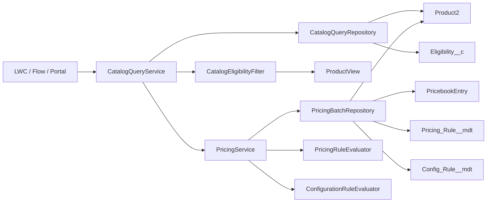

<div align="center">

# ATS Telecom

### Salesforce Revenue, Catalogue & Subscription Platform

Deployable Salesforce metadata for a telecom operator's product catalogue, pricing engine, fibre eligibility, subscription lifecycle, and customer operations.

[](https://developer.salesforce.com/)
[](force-app/main/default/classes)
[](force-app/main/default/classes)
[](force-app/main/default/classes)
[](force-app/main/default)

</div>

---

## Overview

**ATS Telecom** is a Salesforce metadata project built around a simple idea: a telecom catalogue and pricing model should be **server-authoritative, auditable, and deployable**.

The repository contains the deployable Salesforce source for:

- mobile, fibre, and landline plan catalogues;
- device catalogue and commitment-aware configuration;
- metadata-driven pricing rules and bundle adjustments;
- fibre postcode eligibility and speed gating;
- subscription, engagement, and customer-request lifecycles;
- integration logging, wizard state, and retention jobs;
- permission-set-based security for advisor, manager, portal, operations, pricing, and integration personas.

The pricing model is implemented **without a Revenue Cloud Advanced licence**. Instead, the commercial rules live in custom metadata and are evaluated by a small, testable Apex pricing engine.

---

## Why This Project

Most Salesforce telecom demos stop at a product picker. This project focuses on the harder parts:

- **One catalogue read path** for every caller, so advisor and portal experiences cannot drift.
- **Server-side pricing only** — clients render prices, they never calculate them.
- **Governor-limit-aware queries** — batch loads, bounded query counts, no SOQL inside product loops.
- **Configuration rules as metadata** — commitment constraints and pricing adjustments are configurable records, not hard-coded conditionals.
- **Auditable outcomes** — every price breakdown names the rules that fired and every blocked configuration explains why.
- **Least-privilege security** — permission sets, user-mode SOQL, and no custom profiles.

---

## Architecture



### The catalogue and pricing read path

| Component | Responsibility |
|---|---|
| `CatalogQueryService` | Public `@AuraEnabled(cacheable=true)` facade. Validates input, maps `Product2` rows to `ProductView`, and delegates pricing/configuration. |
| `CatalogQueryRepository` | Owns catalogue and eligibility SOQL. Every read uses `WITH USER_MODE`. |
| `CatalogEligibilityFilter` | Pure fibre speed and activation-date decisions. No SOQL, no DML, no mutation of caller data. |
| `PricingService` | Authoritative pricing and configuration entry point. |
| `PricingBatchRepository` | Loads products, pricebook entries, pricing rules, and configuration rules once per batch. |
| `PricingRuleEvaluator` | Pure pricing-rule evaluation, ordered by priority and developer name. |
| `ConfigurationRuleEvaluator` | Pure configuration-constraint evaluation for commitment and companion rules. |

### Governor-limit design

- `getPlans()` performs **one** product query.
- `getDevices()` performs **one** product query.
- `filterByEligibility()` performs **at most one** eligibility query and skips it entirely for non-fibre-only lists.
- `getOptions()` and `getPriceBreakdown()` delegate to `PricingService` and stay within fixed batch budgets.
- No SOQL or DML runs inside a product loop.
- `PricingService.priceBulk()` is capped at **200 requests per call**; larger workloads must be chunked by the caller.
- Eligibility filtering copies the plan view before adding activation metadata, so callers are never mutated.

---

## Pricing Model

The pricing engine follows a transparent, repeatable sequence:

1. Resolve the active `PricebookEntry` for the product.
2. Load active and effective `Pricing_Rule__mdt` records once for the batch.
3. Apply commitment, segment, product-scope, and companion-scope matching.
4. Apply bundle adjustments such as the 30% device bundle discount.
5. Evaluate `Config_Rule__mdt` constraints, including the `NOCOMMIT` device restriction.
6. Return a `PriceBreakdown` containing:
   - list price;
   - adjustment total;
   - final price;
   - applied rules;
   - blocking reasons;
   - warning reasons.

This gives the UI an auditable answer instead of a single opaque number.

### Custom metadata types

| Type | Records | Purpose |
|---|---:|---|
| `Pricing_Rule__mdt` | 4 | Commitment variants and bundle adjustments |
| `Config_Rule__mdt` | 1 | Product configuration constraints |
| `Pricing_Procedure__mdt` | 5 | Ordered five-step pricing procedure |
| `Engagement_Penalty__mdt` | 6 | Commitment penalty matrix |
| `External_Api__mdt` | 3 | Governed external endpoint configuration |

---

## Domain Model

| Domain | Objects |
|---|---|
| Catalogue | `Product2`, `Pricebook2`, `Product_Classification__c` |
| Subscriptions | `Subscription__c`, `Engagement__c` |
| Serviceability | `Eligibility__c` |
| Customer operations | `Customer_Request__c`, `Case` |
| Guided selling | `Subscription_Wizard_State__c`, `Opportunity`, `Quote` |
| Integration and audit | `Integration_Log__c` |
| Revenue configuration | 5 custom metadata types |

### Core relationships

- An `Account` owns many `Subscription__c` records.
- A `Subscription__c` can have an `Engagement__c` commitment period.
- A `Customer_Request__c` links the request, customer, subscription, case, and — for fibre — the serviceability record.
- `Eligibility__c` is keyed by unique postcode and drives fibre availability, speed caps, and earliest activation.
- `Integration_Log__c` provides a correlation-friendly audit trail for external operations.

---

## Repository Layout

```text
force-app/main/default/
├── classes/              # 18 Apex classes, including 6 test classes
├── customMetadata/       # 19 records across 5 metadata types
├── customPermissions/    # 4 custom permissions
├── duplicateRules/       # MSISDN duplicate protection
├── flows/                # 2 active Flows
├── globalValueSets/      # 3 shared value sets
├── labels/               # 12 custom labels
├── layouts/              # 20 page layouts
├── matchingRules/        # MSISDN matching rule
├── objects/              # 7 custom objects, 1 custom setting, 14 extended standard objects
├── permissionsets/       # 8 persona permission sets
├── tabs/                 # 6 custom object tabs
├── translations/         # French translations
└── triggers/             # 1 trigger
```

### Metadata at a glance

| Metadata | Count |
|---|---:|
| Custom objects | 7 |
| Hierarchy custom settings | 1 |
| Custom metadata types | 5 |
| Standard objects extended | 14 |
| Field definitions | 223 |
| Validation rules | 10 |
| Compact layouts | 6 |
| Page layouts | 20 |
| Permission sets | 8 |
| Custom permissions | 4 |
| Global value sets | 3 |
| Custom labels | 12 |
| Apex classes | 18 |
| Test classes | 6 |
| Triggers | 1 |
| Flows | 2 |
| Custom object tabs | 6 |
| Duplicate rules | 1 |
| Matching rules | 1 |

---

## Security Model

Security is intentionally permission-set-first.

| Permission set | Persona |
|---|---|
| `ats_Admin` | System administrator / full build access |
| `ats_Advisor` | Sales advisor guided journey |
| `ats_AdvisorManager` | Advisor manager with elevated visibility |
| `ats_ServiceAgent` | Customer service and request handling |
| `ats_PortalUser` | Portal self-service persona |
| `ats_PricingAdmin` | Pricing and catalogue administration |
| `ats_OpsAdmin` | Operations and integration support |
| `ats_IntegrationUser` | Read-oriented integration user |

Key controls:

- catalogue and eligibility reads use `WITH USER_MODE`;
- pricing and configuration classes are `with sharing`;
- the pricing engine performs no DML;
- custom permissions gate force activation, penalty-approval bypass, margin visibility, and BSS batch execution;
- no custom profiles are required;
- the integration user is deliberately excluded from human-facing UI class access.

---

## Deploy

### Prerequisites

- Salesforce CLI (`sf`)
- A Salesforce org that supports **API 68.0**
- Permission to deploy metadata and assign permission sets

### Authenticate

```bash
sf org login web --alias ats-dev --set-default
```

### Deploy the metadata

```bash
sf project deploy start \
  --source-dir force-app/main/default \
  --target-org ats-dev \
  --wait 30
```

### Run the local test suite

```bash
sf apex run test \
  --target-org ats-dev \
  --test-level RunLocalTests \
  --code-coverage \
  --result-format human \
  --wait 60
```

### Assign a persona

```bash
sf org assign permset --name ats_Admin --target-org ats-dev
```

Repeat for the persona sets required by the target org.

### Seed catalogue data

When the seed CSVs are available under `data/seed/`, the repository includes:

```powershell
pwsh ./scripts/seed-catalogue.ps1 -TargetOrg ats-dev
```

The script is idempotent: products and eligibility records are upserted by external ID, and pricebook entries are matched by pricebook and product.

---

## Testing & Quality

Latest verified local org run:

| Suite | Result |
|---|---|
| `CatalogQueryServiceTest` | **16/16 passing** |
| Focused E2 suite | **37/37 passing** |
| Full local suite | **76/76 passing** |
| Org-wide coverage | **87%** |
| `CatalogQueryService` | **100%** |
| `CatalogQueryRepository` | **100%** |
| `CatalogEligibilityFilter` | **100%** |

The test suite covers:

- offer-type validation;
- active and retired products;
- commitment filtering;
- device images;
- fibre speed caps and no-fibre postcodes;
- future activation dates;
- non-fibre and mixed-list pass-through;
- null and empty inputs;
- configuration blocking;
- pricing delegation;
- bounded query counts;
- immutable eligibility results;
- 200-request bulk pricing and the 201-request guard.

A real-org smoke test also confirms:

- 4 mobile plans, 2 fibre plans, and 3 devices returned;
- `75001` exposes both fibre speeds; `59000` exposes none;
- Mobile 20 GB at `COMMIT12` prices at **13.49**;
- Samsung S22 returns **1** `NOCOMMIT` block and **0** `COMMIT12` blocks.

---

## Design Principles

| Principle | Implementation |
|---|---|
| Single source of truth | `CatalogQueryService` is the only catalogue/pricing read facade |
| Server-authoritative pricing | Clients never calculate a price |
| Metadata over hard-coding | Pricing and configuration rules live in custom metadata |
| Bulk by default | Batch repository loads and pure evaluators |
| Governor-limit discipline | Bounded queries, no per-row SOQL, explicit batch cap |
| Security by design | User-mode reads, `with sharing`, permission sets |
| Testable core | Evaluators are pure and independently testable |
| Auditable pricing | Every applied rule and blocking reason is returned |

---

## Roadmap

- [x] Data model, security model, layouts, validation, and seed catalogue
- [x] Custom Revenue Core pricing engine
- [x] Catalogue and pricing read facade
- [x] Fibre eligibility and speed gating
- [x] Subscription lifecycle and integration audit objects
- [ ] E5 advisor wizard caller wiring
- [ ] E7 portal caller wiring
- [ ] E6 renewal outreach scheduler
- [ ] E8 BSS reconciliation batch
- [ ] CI workflow for metadata validation and test gates

---

## Notes

- The deployable contract is `force-app/main/default`.
- The project targets Salesforce API **68.0**.
- The pricing simulation is an intentional substitute for Revenue Cloud Advanced, which is not licensed in the target environment.
- Generated artefacts, local scratch files, and org authentication state are excluded from the deployable metadata.

---

<div align="center">

**Built for clarity, auditability, and scale.**

</div>
