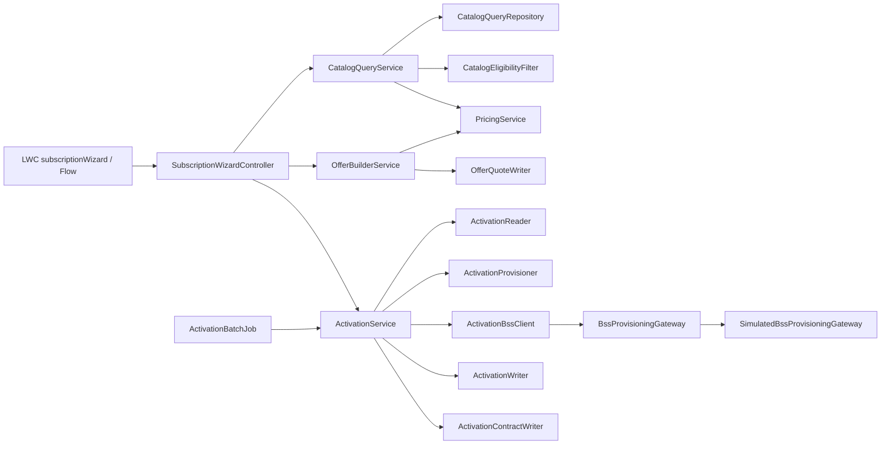

<div align="center">

# SFDX Telecom

### Salesforce Revenue, Catalogue, Subscription & Activation Platform

Deployable Salesforce metadata for a telecom operator's catalogue, server-side pricing, fibre eligibility, five-step subscription wizard, atomic order activation, and BSS integration boundary.

[](https://developer.salesforce.com/)
[](force-app/main/default/classes)
[](force-app/main/default/classes)
[](force-app/main/default)

</div>

---

## Overview

**SFDX Telecom** is built around a simple idea: a telecom catalogue and quote-to-activation flow should be **server-authoritative, auditable, deployable, and safe under bulk load**.

The repository contains the deployable Salesforce source for:

- mobile, fibre, and landline plans, devices, and commitment-aware configuration;
- metadata-driven pricing rules and bundle adjustments;
- fibre postcode eligibility and speed gating;
- a five-step advisor subscription wizard with resumable state;
- quote creation through `OfferBuilderService`;
- quote-to-order hand-off and atomic order activation;
- subscription lifecycle validation and MSISDN uniqueness;
- BSS provisioning behind a replaceable gateway;
- integration logging, batch activation, cleanup jobs, and permission-set security.

The pricing model is implemented **without a Revenue Cloud Advanced licence**. Commercial rules live in custom metadata and are evaluated by a small, testable Apex pricing engine. No LWC calculates a price.

---

## Current Status

| Area | State |
|---|---|
| Data model, security model, layouts, validation, seed catalogue | Complete |
| Custom pricing engine, catalogue facade, fibre eligibility | Complete |
| Quote builder and five-step subscription wizard | Complete |
| Atomic activation, Flow entry point, idempotency, bulk proof | Complete |
| Subscription state machine and MSISDN duplicate handling | Complete |
| Renewal, cancellation, and remaining lifecycle jobs | Partially blocked on business decisions |
| Real BSS callout and reconciliation batch | Partial: simulated gateway in use |
| Portal experience | Deferred: no Experience Cloud licence |
| Non-admin CRUD/FLS hardening | Complete: advisor and manager activation permissions verified |

Latest verified local Apex suite: **168/168 passing**, including `ActivationServiceTest` **26/26**, `SubscriptionWizardControllerTest` **21/21**, and `ActivationPermissionSetTest` **5/5**.

---

## Why This Project

Most Salesforce telecom demos stop at a product picker. This project focuses on the harder parts:

- **One catalogue read path** for every caller, so advisor and portal experiences cannot drift.
- **Server-side pricing only** — clients render prices, they never calculate them.
- **Metadata-driven commercial rules** — commitment constraints and pricing adjustments are configurable records, not hard-coded conditionals.
- **Atomic activation** — local provisioning is savepoint-guarded and rolled back when BSS fails.
- **Idempotent retries** — an already activated order is a no-op, and a retry cannot create a second Subscription or a second BSS call.
- **Bulk-safe by design** — bounded pricing batches, a 10-order synchronous activation cap, and queueable fan-out for larger activation batches.
- **Auditable outcomes** — price breakdowns name the rules that fired, failures are logged, and batch chunks share a correlation ID.
- **Least-privilege security** — permission sets, user-mode reads, and no custom profiles.

---

## Architecture



### Catalogue and pricing read path

| Component | Responsibility |
|---|---|
| `CatalogQueryService` | Public `@AuraEnabled(cacheable=true)` facade. Validates input, maps `Product2` rows to `ProductView`, and delegates pricing/configuration. |
| `CatalogQueryRepository` | Owns catalogue and eligibility SOQL. Every read uses `WITH USER_MODE`. |
| `CatalogEligibilityFilter` | Pure fibre speed and activation-date decisions. No SOQL, no DML, no mutation of caller data. |
| `PricingService` | Authoritative pricing and configuration entry point. |
| `PricingBatchRepository` | Loads products, pricebook entries, pricing rules, and configuration rules once per batch. |
| `PricingRuleEvaluator` | Pure pricing-rule evaluation, ordered by priority and developer name. |
| `ConfigurationRuleEvaluator` | Pure configuration-constraint evaluation for commitment and companion rules. |

### Commerce and activation path

| Component | Responsibility |
|---|---|
| `SubscriptionWizardController` | Server-side state boundary for the five-step wizard, account/contact context, resumable state, and `finishAndActivate()`. |
| `OfferBuilderService` | Quote-creation facade. Consumes `PricingService` output and never performs price arithmetic. |
| `ActivationService` | Transaction facade: validates, locks orders, orchestrates local provisioning, calls BSS, commits, or rolls back to `Ready`. |
| `ActivationBatchJob` | Queueable fan-out for activation batches. Splits work into independent 10-order chunks and enforces a 500-order ceiling. |
| `ActivationReader` | Order locking, SOQL, and per-line context construction. |
| `ActivationContext` | Pure commitment/product rules and the working activation context. |
| `ActivationProvisioner` | Creates Assets, Subscriptions, and Engagements for recurring plan lines. |
| `ActivationBssClient` | BSS request/response boundary and BSS response DML. |
| `ActivationWriter` | Order lifecycle updates, item numbers, and success/failure audit logs. |
| `ActivationContractWriter` | Isolated contract binding. Current default is amend; no `ContractLineItem` is created. |

### Governor-limit design

- `getPlans()` and `getDevices()` use bounded batch queries; no SOQL runs inside a product loop.
- `filterByEligibility()` performs at most one eligibility query and skips it entirely for non-fibre-only lists.
- `PricingService.priceBulk()` is capped at **200 requests per call**; larger workloads must be chunked by the caller.
- `ActivationService` caps a synchronous call at **10 orders**. Each order owns a savepoint and roughly seven SOQL/DML statements.
- `ActivationBatchJob` splits a 200-order batch into 20 queueable jobs and a 500-order batch into 50 jobs.
- The activation governor test asserts the 10-order budget: **100 SOQL / 150 DML / 10,000 ms**.
- Batch activation uses one shared correlation ID across all chunks and per-order logs.

---

## Pricing Model

The pricing engine follows a transparent, repeatable sequence:

1. Resolve the active `PricebookEntry` for the product.
2. Load active and effective `Pricing_Rule__mdt` records once for the batch.
3. Apply commitment, segment, product-scope, and companion-scope matching.
4. Apply bundle adjustments such as the 30% device bundle discount.
5. Evaluate `Config_Rule__mdt` constraints, including the `NOCOMMIT` device restriction.
6. Return a `PriceBreakdown` containing:
   - list price;
   - adjustment total;
   - final price;
   - applied rules;
   - blocking reasons;
   - warning reasons.

`OfferBuilderService` consumes this output when creating a Quote and QuoteLineItems; it does not recompute or round prices independently.

### Custom metadata types

| Type | Records | Purpose |
|---|---:|---|
| `Pricing_Rule__mdt` | 4 | Commitment variants and bundle adjustments |
| `Config_Rule__mdt` | 1 | Product configuration constraints |
| `Pricing_Procedure__mdt` | 5 | Ordered five-step pricing procedure |
| `Engagement_Penalty__mdt` | 6 | Commitment penalty matrix |
| `External_Api__mdt` | 3 | Governed external endpoint configuration |

---

## Activation Model

Activation is the transaction boundary between the Salesforce order and external BSS provisioning.

1. The Flow/quick action validates that the Order is `Ready`, has an account and order items, and that the `Wizard_Enabled__c` and `BSS_Provisioning_Enabled__c` feature flags are enabled.
2. `ActivationService` locks the Order row with `FOR UPDATE` and confirms it is not already activated.
3. Contract binding is resolved first; the current implementation reuses or creates a `Contract` and activates it after BSS success.
4. Local records are created for recurring plan lines: Asset, Subscription, and Engagement. Device lines inherit the nearest preceding plan engagement.
5. BSS provisioning runs behind `BssProvisioningGateway`. The current `SimulatedBssProvisioningGateway` returns `SIM-{SubscriptionNumber}` until the real named credential exists.
6. On success, the Order is marked `Activated`, item numbers are written back, and a success `Integration_Log__c` entry is recorded.
7. On failure, all local DML is rolled back, the Order returns to `Ready`, `Order.Failure_Reason__c` receives a user-safe message, and a failure log is written. Stack traces are never exposed.

### Idempotency and batch behaviour

- An already activated Order returns `NoOp`; no second Subscription or BSS call is created.
- `Order.BSS_Order_Key__c` is unique per order: shared correlation ID plus `OrderNumber`.
- Successful activation stores the BSS key; retries remain safe.
- `ActivationBatchJob.enqueue()` rejects batches over **500 orders** and creates one queueable job per **10-order** chunk.
- Each chunk writes an `Integration_Log__c` summary with `Operation__c = 'activationBatch'`, status/code `200` or `207`, and counts in `Payload_Summary__c`.
- The 200-order execution test activated 200 subscriptions/assets/contracts across 20 chunks. The 500-order execution test exercised 50 chunks with isolated failures and 50 summaries at the ceiling.

### Wizard hand-off

`SubscriptionWizardController.finishAndActivate(sessionId, quoteId)`:

- locks the wizard session row so a double-click cannot create two orders;
- validates the Quote against the session Account/Contact;
- finds an existing Order by `Order.Name = Quote.QuoteNumber`;
- stores the Quote Id in `Order.Description` because standard Order has no Quote lookup;
- copies product, pricebook entry, quantity, price, description, service date, and commitment from each QuoteLineItem;
- marks the Quote `Accepted`, then calls `ActivationService`;
- deactivates the wizard session only after successful activation or a no-op retry.

If activation fails, the Order remains visible and retryable, and the wizard state is preserved for the user to retry.

---

## Domain Model

| Domain | Objects |
|---|---|
| Catalogue | `Product2`, `Pricebook2`, `Product_Classification__c` |
| Commerce | `Quote`, `QuoteLineItem`, `Order`, `OrderItem`, `Contract`, `Asset` |
| Subscriptions | `Subscription__c`, `Engagement__c` |
| Serviceability | `Eligibility__c` |
| Customer operations | `Customer_Request__c`, `Case` |
| Guided selling | `Subscription_Wizard_State__c`, `Opportunity`, `Quote` |
| Integration and audit | `Integration_Log__c` |
| Feature flags | `ATS_Feature_Flags__c` |

### Core relationships

- An `Account` owns many `Subscription__c` records.
- A `Subscription__c` can have an `Engagement__c` commitment period.
- A `Customer_Request__c` links the request, customer, subscription, case, and — for fibre — the serviceability record.
- `Eligibility__c` is keyed by unique postcode and drives fibre availability, speed caps, and earliest activation.
- `OrderItem.Subscription_Number__c` is the activation back-link to the created Subscription.
- `Integration_Log__c` provides a correlation-friendly audit trail for external operations and activation batches.

---

## Repository Layout

```text
force-app/main/default/
├── classes/              # 48 Apex classes, including 11 test classes
├── customMetadata/       # 19 records across 5 metadata types
├── customPermissions/    # 4 custom permissions
├── duplicateRules/       # MSISDN duplicate protection
├── flows/                # 3 Flows (engagement validation + order activation)
├── globalValueSets/      # 3 shared value sets
├── labels/               # 12 custom labels
├── layouts/              # 20 page layouts
├── lwc/                  # subscriptionWizard component
├── matchingRules/        # MSISDN matching rule
├── objects/              # 7 custom objects, 1 hierarchy setting, 5 metadata types, 14 extended standard objects
├── permissionsets/       # 8 persona permission sets
├── quickActions/         # Order.Validate_the_Order Flow quick action
├── tabs/                 # 6 custom object tabs
├── translations/         # French translations
└── triggers/             # 1 trigger
```

Supporting project assets:

```text
data/seed/                # idempotent catalogue seed CSVs
docs/                     # build checkpoint and verification evidence
pricing-export/           # tracked pricing export, excluded from deploys
scripts/                  # seed, export, restore, and verification scripts
use-cases/                # 80-use-case delivery catalogue and status
```

### Metadata at a glance

| Metadata | Count |
|---|---:|
| Custom objects | 7 |
| Hierarchy custom settings | 1 |
| Custom metadata types | 5 |
| Standard objects extended | 14 |
| Field definitions | 226 |
| Validation rules | 11 |
| Compact layouts | 6 |
| Page layouts | 20 |
| Permission sets | 8 |
| Custom permissions | 4 |
| Global value sets | 3 |
| Custom labels | 12 |
| Apex classes | 48 |
| Test classes | 11 |
| Triggers | 1 |
| Flows | 3 |
| Quick actions | 1 |
| LWC components | 1 |
| Custom object tabs | 6 |
| Duplicate rules | 1 |
| Matching rules | 1 |

---

## Security Model

Security is intentionally permission-set-first.

| Permission set | Persona |
|---|---|
| `ats_Admin` | System administrator / full build access |
| `ats_Advisor` | Sales advisor guided journey |
| `ats_AdvisorManager` | Advisor manager with elevated visibility |
| `ats_ServiceAgent` | Customer service and request handling |
| `ats_PortalUser` | Portal self-service persona |
| `ats_PricingAdmin` | Pricing and catalogue administration |
| `ats_OpsAdmin` | Operations and integration support |
| `ats_IntegrationUser` | Read-oriented integration user |

Key controls:

- catalogue and eligibility reads use `WITH USER_MODE`;
- pricing, catalogue, wizard, offer, and activation classes are `with sharing`;
- the pricing engine performs no DML;
- custom permissions gate force activation, penalty-approval bypass, margin visibility, and BSS batch execution;
- `ActivationService` Apex class access is granted to `ats_Admin`, `ats_OpsAdmin`, `ats_Advisor`, and `ats_AdvisorManager`;
- advisor and manager activation grants are intentionally narrow: Order/OrderItem, Asset, Contract, `Subscription__c`, `Engagement__c`, and `Integration_Log__c` are create/read or create/read/edit as required, with Delete disabled;
- `ActivateContract` and `ActivateOrder` are granted because contract and order activation require those user permissions;
- no custom profiles are required;
- the integration user is deliberately excluded from human-facing UI class access.

**Persona verification:** `ActivationPermissionSetTest` creates low-privilege Standard User test personas, assigns the advisor/manager permission sets, and runs a complete user-mode activation. It asserts the required object/field permissions and proves that both personas can activate an order without falling back to admin mode. The org still uses the shared System Administrator profile for human users, so assigning these permission sets to real non-admin users remains an org administration step.

---

## Deploy

### Prerequisites

- Salesforce CLI (`sf`)
- A Salesforce org that supports **API 68.0**
- Permission to deploy metadata and assign permission sets

### Authenticate

```bash
sf org login web --alias ats-dev --set-default
```

### Deploy the metadata

```bash
sf project deploy start \
  --source-dir force-app/main/default \
  --target-org ats-dev \
  --wait 30
```

`pricing-export/` is tracked in git but excluded from deployment by `.forceignore`.

### Run the local test suite

```bash
sf apex run test \
  --target-org ats-dev \
  --test-level RunLocalTests \
  --result-format human \
  --wait 60
```

Focused activation suite:

```bash
sf apex run test \
  --target-org ats-dev \
  --tests ActivationServiceTest \
  --result-format human \
  --wait 30
```

The 200-order and 500-order activation execution tests add several minutes to the local suite; the fast planner test remains available for chunk-size regression checks.

### Assign a persona

```bash
sf org assign permset --name ats_Admin --target-org ats-dev
```

Repeat for the persona sets required by the target org.

### Seed catalogue data

The repository includes idempotent seed CSVs under `data/seed/`:

```powershell
pwsh ./scripts/seed-catalogue.ps1 -TargetOrg ats-dev
```

Products and eligibility records are upserted by external ID, and pricebook entries are matched by pricebook and product.

---

## Testing & Quality

Latest verified local org run:

| Suite | Result |
|---|---|
| `CatalogQueryServiceTest` | **16/16 passing** |
| `ActivationServiceTest` | **26/26 passing** |
| `SubscriptionWizardControllerTest` | **21/21 passing** |
| `ActivationPermissionSetTest` | **5/5 passing** |
| Full local suite | **168/168 passing** |

The suite covers:

- offer-type validation;
- active and retired products;
- commitment filtering;
- device images;
- fibre speed caps and no-fibre postcodes;
- future activation dates;
- non-fibre and mixed-list pass-through;
- null and empty inputs;
- configuration blocking;
- pricing delegation;
- bounded query counts;
- immutable eligibility results;
- 200-request bulk pricing and the 201-request guard;
- activation idempotency and double-click safety;
- BSS failure, rollback, and retry;
- missing quote lines and missing wizard sessions;
- the 10-order governor budget;
- advisor/manager activation CRUD/FLS and user-mode execution;
- 200-order success across 20 chunks;
- 500-order fan-out across 50 chunks with isolated failures and shared correlation.

A real-org smoke test also confirms:

- 4 mobile plans, 2 fibre plans, and 3 devices returned;
- `75001` exposes both fibre speeds; `59000` exposes none;
- Mobile 20 GB at `COMMIT12` prices at **13.49**;
- Samsung S22 returns **1** `NOCOMMIT` block and **0** `COMMIT12` blocks.

---

## Design Principles

| Principle | Implementation |
|---|---|
| Single source of truth | `CatalogQueryService` is the only catalogue/pricing read facade |
| Server-authoritative pricing | Clients never calculate a price |
| Metadata over hard-coding | Pricing and configuration rules live in custom metadata |
| Bulk by default | Batch repository loads, pure evaluators, and chunked activation |
| Governor-limit discipline | Bounded queries, no per-row SOQL, explicit batch caps |
| Atomic operations | Savepoint-guarded activation with rollback and user-safe errors |
| Idempotent retries | `NoOp` for activated orders and unique BSS keys |
| Security by design | User-mode reads, `with sharing`, permission sets |
| Testable core | Evaluators and activation collaborators are small and independently testable |
| Auditable outcomes | Every applied rule, blocking reason, failure, and batch chunk is recorded |

---

## Roadmap

- [x] Data model, security model, layouts, validation, and seed catalogue
- [x] Custom Revenue Core pricing engine
- [x] Catalogue and pricing read facade
- [x] Fibre eligibility and speed gating
- [x] Subscription lifecycle, state machine, and integration audit objects
- [x] Quote builder (`OfferBuilderService`) and five-step subscription wizard
- [x] E4 activation and wizard hand-off (`UC-COM-03`/`UC-COM-05`)
- [x] Activation idempotency and 200/500-order bulk proof (`UC-COM-06`)
- [x] Activation service split into reader, context, provisioner, BSS, writer, and contract collaborators
- [ ] E6 renewal, cancellation, and remaining lifecycle jobs — partially blocked on Q1/BQ1, BQ4, BQ9, and BQ11
- [ ] E7 portal — deferred; Experience Cloud licence required
- [ ] E8 real BSS callout, reconciliation, and named credentials
- [x] E9 non-admin activation CRUD/FLS hardening
- [ ] CI workflow for metadata validation and test gates

---

## Notes

- The deployable contract is `force-app/main/default`.
- The project targets Salesforce API **68.0**.
- The pricing simulation is an intentional substitute for Revenue Cloud Advanced, which is not licensed in the target environment.
- Contract binding currently uses the “amend” assumption: reuse or create a `Contract` and activate it after BSS success. No `ContractLineItem` is written because standard `ContractLineItem` belongs to `ServiceContract`, not `Contract`; Q1/BQ1 remains open.
- The real BSS callout is pending the `BSS_Api` Named Credential in E8. `SimulatedBssProvisioningGateway` is the current implementation.
- Generated artefacts, local scratch files, and org authentication state are excluded from the deployable metadata.

---

<div align="center">

**Built for clarity, auditability, and scale.**

</div>
