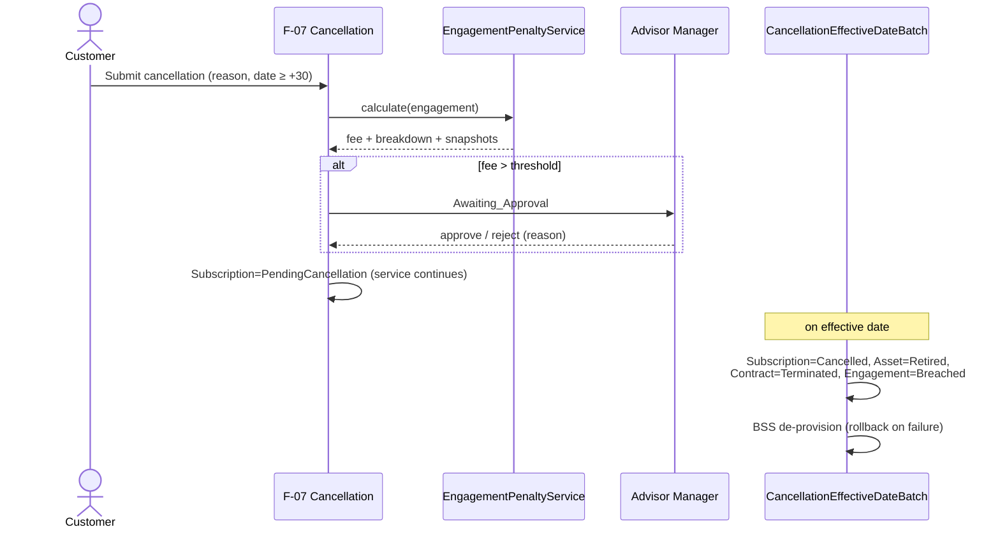
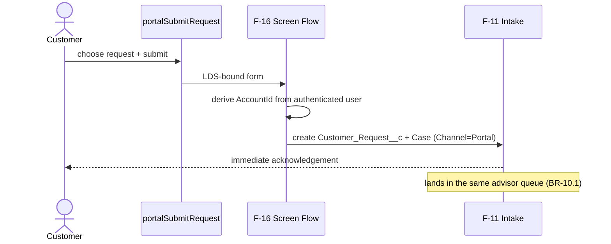

# ATS Telecom — Technical Component Documentation

**Status:** Design specification, not implemented
**Platform:** Salesforce · Revenue Cloud Advanced (RLM) + Experience Cloud · API v68.0
**Companion documents:** [`ARCHITECTURE.md`](./ARCHITECTURE.md) · [`BUSINESS_PROCESS.md`](./BUSINESS_PROCESS.md) · [`DATA_MODEL.md`](./DATA_MODEL.md) · [`use-cases/README.md`](./use-cases/README.md)
**Date:** 2026-10-13
**Author:** Solution Architecture

> This document is the **component-level contract**: every Apex class, trigger, Flow, Lightning Web Component, batch job, and integration that makes up the ATS platform, and what each one does. It is written so that a developer can open a component, read its entry, and know its responsibility, inputs, outputs, dependencies, and security obligations without re-deriving the design. Method and component signatures are the **intended contract**; verify RCA object/field names against your release (`ARCHITECTURE.md` `R4`) before implementation.

---

## 0. How to read this document

| Section | Answers |
|---|---|
| §1 | Component inventory and counts |
| §2 | Layering rules every component obeys |
| §3 | Apex domain services (business logic) |
| §4 | Apex trigger framework and handlers |
| §5 | Apex batch, schedulable, and queueable jobs |
| §6 | Salesforce Flows (orchestration) |
| §7 | Lightning Web Components (advisor console) |
| §8 | Lightning Web Components (Experience Cloud portal) |
| §9 | Integrations (inbound, outbound, events, CDC) |
| §10 | Shared platform configuration referenced by code |
| §11 | Sequence diagrams |
| §12 | Dependency matrix and build/deploy order |
| §13 | Traceability to use cases and processes |

**Naming conventions:** Apex class `PascalCase`; trigger `<Object>Trigger`; handler `<Object>TriggerHandler`; test `<Class>Test`; batch `<Name>Batch`; LWC `kebab-case` folder with `camelCase` `c-` tag; Flow `ATS — <Name>`; custom metadata `ATS_*`.

---

## 1. Component inventory

| Category | Count | Where defined |
|---|---|---|
| Apex domain services | 7 | §3 |
| Apex support/utility classes | 6 | §3.8–§3.13 |
| Apex trigger handlers + triggers | 5 + 5 | §4 |
| Apex batch / schedulable jobs | 4 | §5 |
| Salesforce Flows | 16 | §6 |
| Advisor-console LWCs | 12 | §7 |
| Portal LWCs | 3 | §8 |
| Integrations | 7 | §9 |
| Custom metadata types | 2 | §10 |
| Custom settings | 1 | §10 |
| Custom permissions | 4 | §10 |

**Governing rule (`ARCHITECTURE.md` §7.1):** *Flow orchestrates; Apex executes. Flows invoke Apex — never the reverse. One write path per object.*

---

## 2. Layering and conventions

| Layer | Type | May call | Must not |
|---|---|---|---|
| Orchestration | Flow | Invocable Apex services | Contain complex rollback/callout transactions |
| Domain services | Apex | RCA APIs, other services, DML via `WITH USER_MODE` | Assume single-row; hardcode URLs/keys |
| Trigger layer | Apex trigger + handler | Domain services, `IntegrationLogService` | Call Flows; do DML in the trigger body |
| Integration | Apex + `ExternalApiService` | Named Credentials via `External_Api__mdc` | Cache provisioning; log PII |
| Experience | LWC | LDS wire, Apex controllers (**advisor only**), platform events | Compute price; use Apex controllers in the portal |

**Cross-cutting implementation rules**

| Rule | Implementation | Source |
|---|---|---|
| FLS/CRUD by default | `WITH USER_MODE` on DML; `WITH SECURITY_ENFORCED` on SOQL | `ARCHITECTURE.md` §10 |
| Bulk-safe | No SOQL/DML inside loops; handlers never assume one row | §12 |
| Idempotent | External IDs + state guards | §7.3 |
| Single write path | One handler per object; `Status__c` written only by the state machine | §7.4, X8 |
| No hardcoded endpoints | `External_Api__mdc` | §9 |
| Observable | Every callout logged with a shared `Correlation_Id__c` | X13 |
| No PII in logs | Redact payloads; files not fields | X15 |

---

## 3. Apex classes

### 3.1 Inventory

| Class | Layer | Purpose | Entry point | Key objects |
|---|---|---|---|---|
| `CatalogQueryService` | Domain | Catalogue read + server-side RCA pricing | `@AuraEnabled(cacheable=true)` | `Product2`, `Eligibility__c`, `Quote` |
| `CatalogQueryRepository` | Data access | Single-query catalogue and eligibility reads | internal | `Product2`, `Eligibility__c` |
| `CatalogEligibilityFilter` | Domain helper | Pure fibre speed and activation decisions | internal | `ProductView`, `Eligibility__c` |
| `OfferBuilderService` | Domain | Build quote, order, contract | `@InvocableMethod` | `Quote`, `Order`, `Contract` |
| `ActivationService` | Domain | Atomic, idempotent activation | `@InvocableMethod` | `Order`, `Asset`, `Subscription__c`, `Engagement__c` |
| `EngagementPenaltyService` | Domain | Early-termination fee engine | `@InvocableMethod` | `Engagement__c`, `Engagement_Penalty__mdt` |
| `EligibilityService` | Domain | Fibre coverage resolution | `@AuraEnabled` / `@InvocableMethod` | `Eligibility__c` |
| `ExternalApiService` | Domain/Integration | Single governed callout framework | `public static` | `External_Api__mdc`, `Integration_Log__c` |
| `LeadImportService` | Domain | Bulk lead ingestion | `@RestResource` | `Lead` |
| `IntegrationLogService` | Support | Correlation IDs + logging | `public static` | `Integration_Log__c` |
| `FeatureFlagService` | Support | Read `ATS_Feature_Flags__c` | `public static` | Custom setting |
| `WizardStateService` | Support | Persist/resume wizard state | `@AuraEnabled` | `Subscription_Wizard_State__c` |
| `SubscriptionStateMachine` | Support | Allowed `Status__c` transitions | `public static` | `Subscription__c`, `Engagement__c` |
| `NotificationService` | Support | Activation/confirmation notices | `public static` | `Case`, email/SMS |
| `DmlUtil` / `SecurityUtil` | Support | Safe DML + `stripInaccessible` helpers | `public static` | — |

---

### 3.2 `CatalogQueryService`

**Functionality.** The single authoritative catalogue and pricing read path for **both** the advisor wizard and the portal, so the two can never diverge (`ARCHITECTURE.md` §6.5). It resolves product options through `PricingService` and returns the authoritative `PriceBreakdown`; it never computes a price in code.

| Item | Detail |
|---|---|
| Layer | Domain service (stateless) |
| Called by | `subscriptionWizard` (step 3/4/5), portal My Subscriptions/Submit a Request, `OfferBuilderService` |
| Reads | `CatalogQueryRepository` reads `Product2` and `Eligibility__c`; `PricingService` reads `PricebookEntry`, `Pricing_Rule__mdt`, and `Config_Rule__mdt` |
| Calls | `PricingService` for pricing/configuration, `CatalogQueryRepository` for reads, and `CatalogEligibilityFilter` for pure fibre decisions |
| Security | `WITH USER_MODE` on catalogue and eligibility reads in `CatalogQueryRepository`; `PricingService` is `with sharing`; returns only fields the running user may see |

**Intended contract**

| Member | Signature | Purpose |
|---|---|---|
| `getPlans` | `List<ProductView> getPlans(String offerType, String commitmentCode)` | Mobile/Fibre/Landline plans filtered by `Plan_Type__c`, active flags, and commitment |
| `getDevices` | `List<ProductView> getDevices()` | Active devices with cached `Device_Image_URL__c` |
| `getOptions` | `List<PricingService.ConfigResult> getOptions(Id productId, String commitmentCode)` | Configuration-rule results for a product |
| `getPriceBreakdown` | `PricingService.PriceBreakdown getPriceBreakdown(Id productId, String commitmentCode, String segment, Date effectiveDate, List<String> companionScopes)` | Authoritative server-side price breakdown for the quote line |
| `filterByEligibility` | `List<ProductView> filterByEligibility(List<ProductView>, String postalCode)` | Fibre speed gate (`Max_Downstream_Mbps__c >= Speed_Mbps__c`) |

**Behaviour rules**
- Never returns a client-computed price (`ARCHITECTURE.md` §6.5, X2).
- `ProductView` exposes catalogue attributes plus `earliestActivationDate` and `activationBlocked` for fibre.
- Fibre plans remain selectable when `Earliest_Activation_Date__c > today`, but are marked `activationBlocked` (`BR-02.3`).
- Non-fibre plans pass through `filterByEligibility` unchanged.
- `filterByEligibility` does not mutate the caller's views; it copies a fibre view before setting activation metadata.
- `getPlans` and `getDevices` each issue one product query; `filterByEligibility` issues at most one eligibility query and skips it for non-fibre-only lists. No SOQL or DML runs inside a product loop.
- Portal and advisor receive identical results for identical input (`BR-02.6`, `BR-10.6`).

**Dependencies / tests** — `CatalogQueryRepository`, `CatalogEligibilityFilter`, and `PricingService`; `CatalogQueryServiceTest` passes 16/16, with 100% coverage on the service, repository, and filter (full local suite 76/76 at 87%). **Use cases:** `UC-CAT-08`.

---

### 3.3 `OfferBuilderService`

**Functionality.** Turns a wizard selection into a priced, compliant `Quote`, and (on acceptance) into the `Order` and the `Contract` + `ContractLineItem` commercial container. Delegates configuration and transaction creation to the RCA APIs.

| Item | Detail |
|---|---|
| Layer | Domain service |
| Called by | Activation/Quote Flows, `subscriptionWizard` (step 5), plan-change Flow |
| Writes | `Quote`, `QuoteLineItem`, `Order`, `OrderItem`, `Contract`, `ContractLineItem` |
| Reads | `Quote`, `Product2`, `PricebookEntry`, `Eligibility__c` |
| Calls | `CatalogQueryService`, RCA Configuration + Transaction APIs |

**Intended contract**

| Member | Signature | Purpose |
|---|---|---|
| `createQuote` | `List<QuoteResult> createQuote(List<QuoteRequest>)` `@InvocableMethod` | Build quote lines; snapshot `Commitment_Option_Code__c` |
| `createOrder` | `List<OrderResult> createOrder(List<OrderRequest>)` | Order in `Activation_State__c = Ready`; pre-allocate `Subscription_Number__c` |
| `createOrAmendContract` | `ContractResult createOrAmendContract(ContractRequest)` | Term of record; one line per quote line |

**Behaviour rules**
- Rejects a quote with zero priced lines or expired eligibility (`BR-04.4`).
- Snapshots the commitment option so a later catalogue change never alters a signed quote (`BR-03.6`).
- Plan-change branch (amend vs new contract) is **Q1-dependent** (`ARCHITECTURE.md` `R3`).

**Dependencies / tests** — `CatalogQueryService`; `OfferBuilderServiceTest`. **Use cases:** `UC-COM-01`, `UC-COM-02`.

---

### 3.4 `ActivationService`

**Functionality.** The **single most critical transaction** (`BUSINESS_PROCESS.md` §7): atomically converts a `Ready` Order into a provisioned `Asset`, active `Subscription__c`, in-force `Engagement__c`, bound `Contract`, and a confirmed BSS record — or rolls back entirely.

| Item | Detail |
|---|---|
| Layer | Domain service |
| Called by | Activation Flow (custom action), plan-change Flow, BSS batch |
| Writes | `Asset`, `Subscription__c`, `Engagement__c`, `Order`, `Contract`, `AssetContractRelationship`, `Integration_Log__c` |
| Calls | `ExternalApiService` (BSS), `NotificationService`, Platform Event |
| Properties | Atomic, idempotent, bulk-capable, observable (`ARCHITECTURE.md` §7.3) |

**Intended contract**

| Member | Signature | Purpose |
|---|---|---|
| `activate` | `List<ActivationResult> activate(List<Id> orderIds)` `@InvocableMethod` | Entry point from Flow |
| `activateOrder` | `ActivationResult activateOrder(Id orderId)` | Core single-order transaction |
| `validateOrder` | `void validateOrder(Order)` | Activatable, has items, not already activated |
| `activateOrderItem` | `void activateOrderItem(OrderItem, Order)` | Upsert Asset, create Subscription/Engagement, bind contract |
| `provisionBss` | `BssResponse provisionBss(Subscription__c, String correlationId)` | Idempotent callout (key = `Subscription_Number__c`) |

**Transaction steps** (`ARCHITECTURE.md` §7.3) — validate → per item (upsert `Asset` keyed on `OrderItemId`; create `Subscription__c`; create `Engagement__c` **only if** option ≠ `NOCOMMIT`; set `Root_Engagement__c`; bind `Asset↔Contract`) → `Order.Activation_State__c = Activated` → activate contract → BSS callout with rollback → persist BSS IDs → publish event **after commit** → schedule notification → log with one correlation ID.

**Behaviour rules**

| Rule | Source |
|---|---|
| All or nothing (`allOrNone`, rollback on callout failure) | BR-05.1 |
| Double-click safe (state guard + external ID) | BR-05.2, `R8` |
| Bulk safe (200 OrderItems) | BR-05.3, `R9` |
| No engagement, no commitment | BR-05.4 |
| Snapshots at inception, immutable | BR-05.5 |
| Live only when BSS confirms | BR-05.6 |

**Dependencies / tests** — `ExternalApiService`, `NotificationService`, `IntegrationLogService`; `ActivationServiceTest` (6 mandatory scenarios). **Use cases:** `UC-COM-03`, `UC-COM-06`.

---

### 3.5 `EngagementPenaltyService`

**Functionality.** Computes early-termination fees server-side and **reproducibly** from inception snapshots and the `Engagement_Penalty__mdt` matrix. The client value is display-only (fee tampering defence).

| Item | Detail |
|---|---|
| Layer | Domain service |
| Called by | Cancellation Flow, plan-change Flow, portal Submit a Request |
| Reads | `Engagement__c`, `Engagement_Penalty__mdt` |
| Writes | `Engagement__c.Early_Termination_Fee__c`, `Penalty_Rule__c`, `Penalty_Breakdown__c`, `Customer_Request__c.Calculated_Fee__c` |

**Intended contract**

| Member | Signature | Purpose |
|---|---|---|
| `calculate` | `List<PenaltyResult> calculate(List<PenaltyRequest>)` `@InvocableMethod` | Batch fee computation for the Flow |
| `resolveRule` | `Engagement_Penalty__mdt resolveRule(Segment, Category, Duration, Date)` | Lowest `Priority__c` wins |
| `computeFee` | `Decimal computeFee(Engagement__c, Engagement_Penalty__mdt)` | `MIN(MonthsRemaining × Monthly × Rate, Cap × contract)` |
| `isWithinPenaltyFreeWindow` | `Boolean isWithinPenaltyFreeWindow(Engagement__c, rule)` | Window check → fee 0 |

**Formula (design of record)** — `DATA_MODEL.md` §4.5.

**Behaviour rules**
- Missing metadata row → **default rule**, never a user-facing exception (`E9`).
- Expired engagement → `Expired`, fee 0, not `Breached` (`BR-08.9`).
- Because `Monthly_Amount__c` and `Penalty_Rate__c` are snapshots, recalculation years later yields the same figure (`BR-08.4`).

**Dependencies / tests** — `Engagement_Penalty__mdt`; `EngagementPenaltyServiceTest`. **Use cases:** `UC-LIF-01`.

---

### 3.6 `EligibilityService`

**Functionality.** The single source of the eligibility answer for wizard and portal — a postal-code lookup against `Eligibility__c` with the speed gate and activation-date constraint.

| Item | Detail |
|---|---|
| Layer | Domain service |
| Called by | Wizard step 3/5, portal request forms, `CatalogQueryService` |
| Reads | `Eligibility__c` (`Postal_Code__c + Is_Active__c`) |
| Returns | Coverage, max speed, earliest activation, restrictions, technologies |

**Intended contract**

| Member | Signature | Purpose |
|---|---|---|
| `checkCoverage` | `EligibilityResult checkCoverage(String postalCode)` `@AuraEnabled(cacheable=true)` | Single-postcode resolution |
| `checkCoverageBulk` | `List<EligibilityResult> checkCoverageBulk(List<String>)` `@InvocableMethod` | Bulk Flow use |
| `filterEligiblePlans` | `List<Product2> filterEligiblePlans(List<Product2>, EligibilityResult)` | Speed gate |

**Behaviour rules** — no active record ⇒ no fibre offer (`BR-02.1`); results are read-only snapshots (`BR-02.5`); eligibility is a customer attribute, never in the catalogue (`BR-02.4`).

**Dependencies / tests** — `EligibilityServiceTest`. **Use cases:** `UC-CAT-08`, `UC-LIF-01` (eligibility re-check), `UC-DM-05`.

---

### 3.7 `ExternalApiService`

**Functionality.** The one governed callout framework. Every outbound call (BSS, images, weather) resolves its endpoint, auth, timeout, cache TTL, rate limit, and kill switch from `External_Api__mdc`. No URL or key is ever hardcoded.

| Item | Detail |
|---|---|
| Layer | Domain/Integration |
| Called by | `ActivationService`, image-sync Flow, `c-externalApiCard`, `BssReconciliationBatch` |
| Reads | `External_Api__mdc` |
| Writes | `Integration_Log__c` |
| Uses | Named Credentials, Platform Cache |

**Intended contract**

| Member | Signature | Purpose |
|---|---|---|
| `send` | `ApiResponse send(String apiDeveloperName, String method, String path, String body, String correlationId)` | Single entry point |
| `getConfig` | `External_Api__mdc getConfig(String apiDeveloperName)` | Resolve config; fail fast if missing |
| `isActive` | `Boolean isActive(String apiDeveloperName)` | Kill switch without deployment |
| `getFromCache` / `putInCache` | `Object getFromCache(String key)` / `void putInCache(String key, Object value, Integer ttl)` | Cache respecting `Cache_Ttl_Seconds__c` |

**Behaviour rules** — never cache `Bss_Provisioning` (`Cache_Ttl_Seconds__c = 0`, `DATA_MODEL.md` §9.2); missing metadata row fails fast (no hardcoded fallback); secrets stay in the Named Credential; every call logged with correlation ID.

**Dependencies / tests** — `IntegrationLogService`; `ExternalApiServiceTest` (`HttpCalloutMock`). **Use cases:** `UC-INT-06`.

---

### 3.8 `LeadImportService`

**Functionality.** Bulk lead ingestion for campaign lists of thousands, exposed as an Apex REST endpoint backed by the Bulk API.

| Item | Detail |
|---|---|
| Layer | Domain / REST |
| Annotation | `@RestResource(urlMapping='/ats/leads/*')` |
| Called by | `c-leadImport` home-page LWC, external Marketing tooling |
| Writes | `Lead` (chunked, `Database.insert(..., allOrNone=false)`) |

**Intended contract**

| Member | Signature | Purpose |
|---|---|---|
| `doPost` | `void doPost()` | REST entry; parse + delegate |
| `importLeads` | `ImportResult importLeads(List<LeadInput>)` | Chunked upsert with per-row results |
| `toLeads` | `List<Lead> toLeads(List<LeadInput>)` | Map + `Security.stripInaccessible` |

**Behaviour rules** — handles 10,000+ without governor breach (`BR-01.6`); dedupe/consent delegated to the dedupe/scoring step (`BR-01.1`, `BR-01.3`); mass-assignment protected.

**Dependencies / tests** — `LeadImportServiceTest`. **Use cases:** `UC-ACQ-01`.

---

### 3.9 `IntegrationLogService`

**Functionality.** Generates correlation IDs and writes `Integration_Log__c` entries so every transaction chain is diagnosable and reconciliation is automated.

| Member | Signature | Purpose |
|---|---|---|
| `newCorrelationId` | `String newCorrelationId()` | UUID per transaction chain |
| `log` | `void log(LogEntry entry)` | Single log writer |
| `logSuccess` / `logFailure` | `void logSuccess(...)` / `void logFailure(...)` | Convenience wrappers |

**Behaviour rules** — logging failure must never roll back the business transaction; payloads stored as `ContentDocument` (`Payload_Doc__c`), never text; `Error_Stack__c` restricted; no PII/secrets (`X15`).

**Dependencies / tests** — `IntegrationLogServiceTest`. **Use cases:** `UC-INT-02`.

---

### 3.10 `FeatureFlagService`

**Functionality.** Thin reader over the hierarchy custom setting `ATS_Feature_Flags__c`, used as a Flow entry condition so behaviour changes without a deployment.

| Member | Signature | Purpose |
|---|---|---|
| `isWizardEnabled` | `Boolean isWizardEnabled()` | `Wizard_Enabled__c` |
| `isPortalRequestsEnabled` | `Boolean isPortalRequestsEnabled()` | `Portal_Requests_Enabled__c` |
| `isBssProvisioningEnabled` | `Boolean isBssProvisioningEnabled()` | `BSS_Provisioning_Enabled__c` |
| `isExternalApiEnabled` | `Boolean isExternalApiEnabled()` | `External_Api_Enabled__c` |
| `getCancellationApprovalThreshold` | `Decimal getCancellationApprovalThreshold()` | `Cancellation_Approval_Threshold__c` |

**Behaviour rules** — BSS flag off ⇒ activation held in `Ready`, surfaced to ops, never silently skipped (`BR-05.8`).

**Use cases:** `UC-COM-05`, `UC-DM-09`.

---

### 3.11 `WizardStateService`

**Functionality.** Persists and restores the guided-journey session so a dropped connection is recoverable.

| Member | Signature | Purpose |
|---|---|---|
| `save` | `void save(Id advisorId, WizardSnapshot)` `@AuraEnabled` | Upsert the single active state |
| `resume` | `WizardSnapshot resume(Id advisorId)` `@AuraEnabled` | Load state + last step |
| `clear` | `void clear(Id advisorId)` | Delete the active state on completion |

**Behaviour rules** — one active state per advisor; sessions hard-deleted after 7 days (`BR-03.7`, `DATA_MODEL.md` §8.2).

**Dependencies / tests** — `WizardStateServiceTest`. **Use cases:** `UC-UX-07`, `UC-DM-07`.

---

### 3.12 `SubscriptionStateMachine`

**Functionality.** Holds the explicit allowed-transition map and validates every `Status__c` change regardless of DML path — API, data load, Flow, or integration. Called by `SubscriptionTriggerHandler`; **never** by a Flow.

| Member | Signature | Purpose |
|---|---|---|
| `isAllowed` | `Boolean isAllowed(String from, String to)` | Transition map check |
| `assertAllowed` | `void assertAllowed(Subscription__c old, Subscription__c new)` | Add error for illegal transitions |
| `isTerminal` | `Boolean isTerminal(String status)` | `Cancelled`/`Superseded` are terminal |

**Transition map** — `DATA_MODEL.md` §3.3 / `ARCHITECTURE.md` §7.4.

**Use cases:** `UC-COM-04`.

---

### 3.13 `NotificationService`, `DmlUtil`, `SecurityUtil`

| Class | Functionality |
|---|---|
| `NotificationService` | Sends the activation confirmation **after** BSS success (`BR-05.6`); schedules communications; writes the `Case` auto-response. |
| `DmlUtil` | Helpers wrapping `Database.insert/update(..., allOrNone)` with `AccessLevel.USER_MODE`. |
| `SecurityUtil` | Wrappers for `Security.stripInaccessible` on externally supplied field maps (`ARCHITECTURE.md` §10). |

---

### 3.14 `RenewalService` and renewal helpers

| Class | Functionality |
|---|---|
| `RenewalService` | Invocable façade for `RenewSameTerms`, `RenewNewPlan`, `LetLapse`, and `CancelEarly`; `CancelEarly` is rejected before intake. |
| `RenewalValidator` | Validates the source line and decision, resolves fibre eligibility, and obtains the quoted amount from `CatalogQueryService.getPriceBreakdown`. |
| `RenewalIntake` | Creates request/Case pairs through `LifecycleRequestService` with `Request_Type__c = Renewal` and stores the server quote in `Fee_Breakdown__c`. |
| `RenewalFulfilment` | Applies all writes inside one savepoint so a failed renewal leaves the old term unchanged. |
| `RenewalWriter` | Expires the old engagement, inserts a new active engagement for renewals, rolls the billing end forward for lapses, and completes requests/Cases in bulk. |
| `RenewalOutreachBatch` | Scheduled daily scan that creates stage-specific renewal Tasks once per stage per engagement. |

**Use cases:** `UC-LIF-06`, `UC-LIF-08`.

---

## 4. Apex trigger framework and handlers

**Rule (`ARCHITECTURE.md` §7.4, X8):** exactly one trigger and one handler per object. Triggers contain no logic and no DML; they delegate to a handler. Handlers guarantee a single write path for `Status__c` and lifecycle fields, and intercept **every** DML path (UI, API, data load, integration) — a job Flow cannot reliably do.

| Trigger | Handler | Objects | Responsibility |
|---|---|---|---|
| `SubscriptionTrigger` | `SubscriptionTriggerHandler` | `Subscription__c` | Enforce transition map; validate `MSISDN` uniqueness; mirror `Asset.Provisioned_Status__c`; maintain snapshots |
| `EngagementTrigger` | `EngagementTriggerHandler` | `Engagement__c` | Enforce duration ∈ {12,24}; end > start; goodwill justification; breach requires amount (Flow-backed) |
| `CustomerRequestTrigger` | `CustomerRequestTriggerHandler` | `Customer_Request__c` | Resolve `Impacted_Engagement__c` at intake; compute `Is_Compliant_Request__c`; block duplicate in-flight requests |
| `OrderTrigger` | `OrderTriggerHandler` | `Order` | Guard `Activation_State__c` progression; prevent re-entry unless `Ready` |
| `AssetTrigger` | `AssetTriggerHandler` | `Asset` | Maintain `Is_Primary__c` uniqueness per service line; keep `Service_Line_Type__c` mirrored from subscription |

**Handler skeleton pattern**

```
trigger XTrigger on X (before insert, before update, after insert, after update) {
    XTriggerHandler.handle(Trigger.operationType, Trigger.new, Trigger.oldMap);
}
```

**Handler obligations**

| Obligation | Detail |
|---|---|
| Bulk-safe | Iterate collections; no per-row SOQL/DML |
| Recursion guard | Static `Set<Id>` of already-processed records |
| No cross-object writes | Delegate to a domain service; never DML another object directly except the documented mirror |
| Error handling | `addError` for business violations; never swallow |
| Observability | Only trigger-sourced issues logged; no PII |

**Use cases:** `UC-COM-04`, `UC-DM-11`.

---

## 5. Apex batch, schedulable, and queueable jobs

| Job | Type | Schedule | Functionality | Objects |
|---|---|---|---|---|
| `IntegrationLogCleanupBatch` | `Database.Batchable` + `Schedulable` | Weekly | **Hard-delete** `Integration_Log__c` older than 13 months (`DATA_MODEL.md` §14.1) | `Integration_Log__c` |
| `WizardStateCleanupBatch` | Batch + Schedulable | Nightly | **Hard-delete** inactive `Subscription_Wizard_State__c` past `Expires_On__c` | `Subscription_Wizard_State__c` |
| `RenewalOutreachBatch` | Batch + Schedulable | Nightly 03:00 | Creates T−60/T−30/T−7 outreach Tasks once per stage per engagement | `Engagement__c`, `Task` |
| `BssReconciliationBatch` | Batch + Schedulable | Nightly | Compare `Subscription__c` vs BSS; write `External_Status__c` + log drift; retry failed de-provisions | `Subscription__c`, `Integration_Log__c` |
| `CancellationFulfilmentBatch` | Batch + Schedulable | Daily 01:00 | On the effective date: subscription `Cancelled`, asset `Retired`, contract `Terminated`, engagement `Breached`; trigger de-provision | `Subscription__c`, `Asset`, `Contract`, `Engagement__c` |

**Shared characteristics**
- `Database.QueryLocator` for high-volume scans (`DATA_MODEL.md` §13.3).
- Chunked BSS interaction via `ExternalApiService`; idempotency key preserved on retry.
- Failures logged (SLA-9 ≤ 4h triage); dead-letter surfaced to ops (`UC-HRD-05`).
- All jobs are `Schedulable`; activation is driven by `ActivationService`, **not** a batch, to keep atomicity.

**Use cases:** `UC-DM-14`, `UC-INT-04`, `UC-LIF-03` (effective-date fulfilment), `UC-LIF-06` (renewal outreach).

---

## 6. Salesforce Flows (orchestration layer)

Flows are the **orchestration** layer: they own branching, user tasks, screens, and entry points; they delegate real work to invocable Apex (`ARCHITECTURE.md` §7.2). No Flow performs a rollback-critical callout or writes a status field directly.

| # | Flow (`ATS — *`) | Type | Trigger | Delegates to | Objects written |
|---|---|---|---|---|---|
| F-01 | Lead Conversion | Record-triggered | `Lead.Status = Ready` | — (3 records, no rollback) | `Account`, `Contact`, `Opportunity` |
| F-02 | Lead Intake (bulk/portal) | Screen/Autolaunched | Import or guest form | `LeadImportService` (bulk) | `Lead` |
| F-03 | Eligibility Check | Autolaunched | Wizard step 3 / portal form | `EligibilityService` | `Opportunity.Eligibility_Checked__c` |
| F-04 | Quote to Order | Autolaunched | Accepted quote | `OfferBuilderService` | `Quote`, `Order`, `Contract` |
| F-05 | Order Activation | Record-triggered + Custom Action | "Validate the Order" | `ActivationService` | `Order`, `Asset`, `Subscription__c`, `Engagement__c` |
| F-06 | Plan Change | Screen + Autolaunched | Portal/advisor request | `CatalogQueryService`, `OfferBuilderService`, `ActivationService` | `Customer_Request__c`, `Quote`, `Order` |
| F-07 | Cancellation | Screen + Autolaunched | Portal/advisor request | `EngagementPenaltyService`, `ActivationService` | `Customer_Request__c`, `Engagement__c`, `Subscription__c` |
| F-08 | Suspension / Unfreeze | Screen + Autolaunched | Request | status update via handler | `Subscription__c`, `Customer_Request__c` |
| F-09 | Equipment Swap | Screen + Autolaunched | Request | — | `Asset`, `Customer_Request__c` |
| F-10 | Portability | Screen + Autolaunched | Request | `ExternalApiService` | `Subscription__c`, `Customer_Request__c` |
| F-11 | Request Intake (shared skeleton) | Autolaunched / Subflow | Any lifecycle request | — | `Customer_Request__c`, `Case` |
| F-12 | Fee Approval Gate | Autolaunched | Fee threshold breach | `FeatureFlagService` | `Customer_Request__c.Approved_By__c` |
| F-13 | Renewal Outreach | **Scheduled** | Daily T−60/30/7 scan | `RenewalOutreachService` | `Engagement__c`, `Task` |
| F-14 | Product Image Sync | **Scheduled** | Daily | `ExternalApiService` | `Product2.Device_Image_URL__c` |
| F-15 | Activation Confirmation | Autolaunched | Platform event | `NotificationService` | `Case`, email/SMS |
| F-16 | Portal Submit a Request | **Screen** | Portal customer | F-11, F-06/F-07/F-08 | `Customer_Request__c`, `Case` |

**Key Flow contracts**

| Flow | Critical behaviour | Source |
|---|---|---|
| F-01 | Idempotent conversion via `Legacy_Customer_Id__c`; no second Account | BR-01.4 |
| F-05 | Entry point + friendly error surface; Apex guarantees atomicity; holds in `Ready` if BSS flag off | §7.2 #5, BR-05.8 |
| F-06 | Amend path keeps the same term; approval gate on fee > threshold | BR-06.1, X10 |
| F-07 | Reason + 30-day notice enforced; fee server-side; `PendingCancellation` until effective date | BR-08.1–08.8 |
| F-11 | One intake skeleton reused by F-06…F-10; `Info` creates no Case | X1, BR-10.7 |
| F-13 | Stage-prefixed Task subjects guard duplicate outreach; `Renewal_Contacted__c` stamped on first contact; DNC email-only | BR-09.1, BR-09.2 |
| F-14 | Cached image URLs only; never a live callout per render | §8.2 |
| F-16 | `AccountId` derived server-side; LDS-only; no portal Apex controllers | X12, §8.3 |

**Portal screen flows** (F-16 detail) reuse F-11 and land in exactly the same back-office queues — only `Channel__c` differs (`BR-10.1`).

**Use cases:** `UC-ACQ-05`, `UC-COM-05`, `UC-LIF-02…08`, `UC-POR-04`, `UC-POR-06`, `UC-INT-05`.

---

## 7. Lightning Web Components — Advisor Console

Design reference: `ARCHITECTURE.md` §8.1–8.2. Governance: keep each zone a separate child component so the shell is stable (`R15`).

| LWC | Type | Data source | Functionality |
|---|---|---|---|
| `customer360Shell` | Composed container | LDS + Apex | Hosts the four zones + external card; Highlights actions **Subscribe** / **Unsubscribe** |
| `customerInformationZone` | Child | `lightning-record-field` | Identity, segment, active line count |
| `statusBadge` | Child (reusable) | Apex/derived | Computes `Prospect/Subscribed/Suspended/Churned` pill — never a stored flag |
| `subscriptionsZone` | Child | LDS / `lightning-datatable` | Lines with status pill, plan, monthly price; **Unsubscribe** row action → request; **Subscribe** button |
| `hardwareZone` | Child | LDS | `Asset` devices: image (cached URL), serial, colour, status; Equipment-swap action |
| `interactionsZone` | Child | LDS / timeline | Cases, Opportunities, Quotes, Orders history |
| `externalApiCard` | Child | `ExternalApiService` | Contextual data card (e.g. weather); graceful degradation |
| `subscriptionWizard` | Container | Apex + LDS | 5-step journey orchestrator; persists state; calls `CatalogQueryService` / `OfferBuilderService` / `ActivationService` |
| `wizardStep1Confirm` | Child | `updateRecord` (debounced) | Confirm/correct Account/Contact with debounced write-back |
| `wizardStep2Offer` | Child | — | Choose Mobile / Landline |
| `wizardStep3Plan` | Child | Apex wire | Plan + commitment option; eligibility filter for fibre |
| `wizardStep4Device` | Child | Apex wire | Device picker; `Requires_Commitment__c` constraint; cached images |
| `wizardStep5Confirm` | Child | Apex | Server price breakdown (read-only); "Finish & Activate" |
| `leadImport` | Home-page | Apex REST | Upload campaign file → `LeadImportService`; result summary |

**Component contracts**

| Component | Public API | Events | Notes |
|---|---|---|---|
| `customer360Shell` | `@api recordId` | publishes context to children | Actions inherit account context — no re-selection (`BR-11.3`) |
| `subscriptionsZone` | `@api accountId` | `unsubscribe` → parent opens request | Unsubscribe **never** cancels directly (`BR-08.3`); disabled with reason when in-flight (`BR-11.2`) |
| `statusBadge` | `@api status`, `@api activeLines` | — | Derived only (`BR-11.1`) |
| `subscriptionWizard` | `@api accountId`, `@api resumeState` | `quoteready`, `activated` | One active state per advisor; debounced step-1 sync |
| `wizardStep5Confirm` | `@api quoteId`, `@api priceBreakdown` | `activate` | Renders server price only (`§6.5`) |
| `externalApiCard` | `@api accountId` | — | No secret client-side |

**Data-access rules:** advisor LWCs may use Apex controllers; price is never computed in JS; device images come from `Device_Image_URL__c`; jest tests cover component logic only (`ARCHITECTURE.md` §12).

**Use cases:** `UC-UX-01…07`, `UC-ACQ-02`.

---

## 8. Lightning Web Components — Experience Cloud Portal

Design reference: `ARCHITECTURE.md` §8.3. **Hard rule: no Apex controllers in the portal.** Reads via LDS wire adapters (FLS enforced); writes via secured Apex with `WITH USER_MODE`.

| LWC | Experience | Access | Functionality |
|---|---|---|---|
| `portalMySubscriptions` | My Subscriptions | Read-mostly (LDS) | Active plans + equipment, scoped to the authenticated Account |
| `portalTrackRequests` | Track My Requests | Read (LDS/Apex) | Quotes, Orders, Customer Requests, Cases by status; fee fields read-only |
| `portalSubmitRequest` | Submit a Request | Write (secured Apex) | Plan change / cancellation / suspension / info → `Customer_Request__c` + `Case` |

**Portal contracts**

| LWC | Public API | Data path | Security obligations |
|---|---|---|---|
| `portalMySubscriptions` | none (page-scoped) | LDS wire | `AccountId` derived server-side; paginate with `LIMIT` |
| `portalTrackRequests` | none | LDS/Apex | Own-account scope; `Calculated_Fee__c` read-only (`BR-10.3`) |
| `portalSubmitRequest` | `@api requestType` | Screen Flow F-16 | Never accept client AccountId (`X12`); cannot approve (`BR-10.4`) |

**Hard constraints**

| Constraint | Source |
|---|---|
| No Apex controller classes in the portal | §8.3 |
| `WITH USER_MODE` on every write; no bare DML | §10 |
| Portal never holds `Integration_Log__c` access | §17.1 |
| Same pricing path as advisor | BR-10.6 |

**Use cases:** `UC-POR-02…05`.

---

## 9. Integrations

| # | Integration | Direction | Mechanism | Endpoint source | Functionality |
|---|---|---|---|---|---|
| I-01 | BSS/OSS provisioning | SF → BSS | Named Credential + `@future(callout=true)` / Batch | `Bss_Provisioning` | The activation boundary; idempotent (key = `Subscription_Number__c`); rollback on failure |
| I-02 | BSS status reconciliation | BSS → SF | Scheduled Batch + Platform Cache | `Bss_Provisioning` | Writes `External_Status__c`; detects drift; retries de-provisions |
| I-03 | Product image API | SF → external | Scheduled Flow → `ExternalApiService` | `Product_Image` | Syncs `Device_Image_URL__c` (cached; no per-row callout) |
| I-04 | Weather / contextual API | SF → external | `ExternalApiService` + Platform Cache | `Weather` | Demonstrates the integration pattern on the 360° card |
| I-05 | Service events | internal | **Platform Events** `ats.service.activated.v1` | — | Published **after commit** (outbox); drives confirmation (F-15) |
| I-06 | Reporting / BI | outbound | **Change Data Capture** → Data Cloud / Power BI | — | CDC on the 4 custom objects + `Asset` |
| I-07 | Marketing | outbound | Marketing Cloud (`Lead` + Journey Builder) | — | Detail out of scope; gated by `Consent_Given__c` (`X11`) |

**Integration rules**

| Rule | Source |
|---|---|
| No hardcoded URL/key — always `External_Api__mdc` | §9 |
| Secrets stay in Named Credentials — never reach a client | §9.2, §8.3 |
| Provisioning must never be cached (`Cache_Ttl_Seconds__c = 0`) | §9.2 |
| Every callout idempotent + logged with a correlation ID | X13 |
| Platform events published after commit, never inside the transaction | §7.3 |
| Dead API disabled via `Is_Active__c` without a deployment | §9.2 |

**Use cases:** `UC-INT-01…07`, `UC-COM-03`, `UC-LIF-03`.

---

## 10. Shared platform configuration referenced by code

| Artifact | Type | Referenced by | Purpose |
|---|---|---|---|
| `Engagement_Penalty__mdt` | Custom metadata | `EngagementPenaltyService` | Penalty matrix; lowest `Priority__c` wins; 6 seed rows |
| `External_Api__mdc` | Custom metadata | `ExternalApiService` | Endpoint/auth/cache/throttle config; 3 seed rows |
| `ATS_Feature_Flags__c` | Hierarchy custom setting | `FeatureFlagService`, Flows | Kill switches + `Cancellation_Approval_Threshold__c` |
| `ats_Force_Activation__c` | Custom permission | Activation Flow | Bypass the "not activatable" guard |
| `ats_Bypass_Penalty_Approval__c` | Custom permission | Fee approval Flow | Manager override above threshold |
| `ats_View_Margin__c` | Custom permission | `subscriptionWizard` | Show cost/margin to authorized advisors |
| `ats_Run_BSS_Batch__c` | Custom permission | Ops UI | Trigger reconciliation from the UI |
| Global value sets | `ATS_Subscription_Status`, `ATS_Request_Channel`, `ATS_Service_Line_Type` | Objects + LWCs | Reused picklists |
| Custom labels (12) | Labels EN/FR | LWCs, Flows | UI microcopy / translation |

Sources: `DATA_MODEL.md` §9.1–9.7, `ARCHITECTURE.md` §9.

---

## 11. Sequence diagrams

### 11.1 Activation (atomic, idempotent)

```mermaid
sequenceDiagram
    actor Advisor
    participant Flow as F-05 Order Activation
    participant Svc as ActivationService
    participant BSS as ExternalApiService → BSS
    participant Log as IntegrationLogService
    participant Event as Platform Event

    Advisor->>Flow: "Validate the Order"
    Flow->>Svc: activate(orderId)
    Svc->>Svc: validate (Ready, items, not activated)
    Svc->>Svc: upsert Asset, create Subscription + Engagement, bind Contract
    Svc->>BSS: provision (idempotency key)
    alt BSS success
        BSS-->>Svc: 200 + BSS ids
        Svc->>Svc: Order=Activated; persist ids
        Svc->>Event: publish ats.service.activated.v1 (after commit)
    else BSS failure
        BSS-->>Svc: 500
        Svc-->>Flow: rollback; Order=Ready
    end
    Svc->>Log: log every step (one Correlation_Id__c)
    Flow-->>Advisor: success / friendly error
```

### 11.2 Cancellation (fee → approval → fulfilment)



### 11.3 Portal request (no Apex controller, server-derived identity)



---

## 12. Dependency matrix and build order

| Component | Depends on | Deployed in phase |
|---|---|---|
| Trigger handlers | Objects + `SubscriptionStateMachine` | E1/E4 |
| `IntegrationLogService`, `FeatureFlagService`, `WizardStateService` | Custom objects + settings | E1 |
| `EligibilityService` | `Eligibility__c` | E3/E5 |
| `CatalogQueryService` | RCA catalog + pricing procedure | E2 |
| `OfferBuilderService` | `CatalogQueryService`, RCA transaction API | E4 |
| `ExternalApiService` | `External_Api__mdc` | E8 |
| `ActivationService` | `ExternalApiService`, `NotificationService`, handlers | E4 |
| `EngagementPenaltyService` | `Engagement_Penalty__mdt` | E6 |
| `LeadImportService` | `Lead` extensions | E3 |
| Batch jobs | Objects + schedulers | E1/E8 |
| Flows | Their invocable services | E3–E7 |
| Advisor LWCs | Apex services + FlexiPages | E5 |
| Portal LWCs | Flows + security model | E7 |

**Deploy order (`DATA_MODEL.md` §19):** Global value sets/labels → metadata types → setting → objects → fields → formulas → validation/duplicate rules → compact layouts → **Flows → Apex → LWC → FlexiPages/Tabs → permission sets → seed**.

> RCA-dependent lookups (`ProductClassification__c`, `Selling_Model_Option__c`, `Quote/Order/Asset/Contract` extensions) deploy **only after** RCA is enabled — split into a separate increment if RCA arrives late.

---

## 13. Traceability

| Component group | Business processes | Architecture | Use cases |
|---|---|---|---|
| Data/trigger layer | all | §5, §7.4 | `UC-DM-*`, `UC-COM-04` |
| Catalog & pricing services | 03 | §6 | `UC-CAT-01…09` |
| Acquisition | 01 | §7.2 | `UC-ACQ-01…05` |
| Commerce & activation | 04, 05 | §7.1–7.4 | `UC-COM-01…06` |
| Advisor experience | 03, 11 | §8.1–8.2 | `UC-UX-01…07` |
| Lifecycle | 06, 07, 08, 09 | §7.2, §7.4 | `UC-LIF-01…08` |
| Portal | 10 | §8.3 | `UC-POR-01…06` |
| Integrations | 05, 07, 08 | §9 | `UC-INT-01…07` |
| Hardening/NFR | all | §12 | `UC-HRD-01…08` |

---

## 14. Open items affecting components

| # | Item | Affects |
|---|---|---|
| Q1 / BQ1 | Plan change = amend or new contract | `OfferBuilderService.createOrAmendContract`, F-06 |
| Q3 | Billing in Salesforce? | `Invoice__c`/`Payment__c` (not modelled), Phase 10 |
| Q4 / BQ8 | Fibre eligibility source | `EligibilityService`, I-06 (image/eligibility sync) |
| BQ3 | Resolved 2026-11-19 — suspension does not pause the clock | F-08, `SuspensionService` (Contract and Engagement untouched) |
| BQ4 | Resolved 2026-11-19 — expired commitments roll monthly | F-13, `RenewalService` (`LetLapse`) |
| BQ11 | Device penalty-free window | `Engagement_Penalty__mdt` seed, `EngagementPenaltyService` |
| R4 | RCA field names differ by release | every service calling RCA APIs |
| R13 | Decision tables not activated | `CatalogQueryService`, pricing test harness |

Sources: `use-cases/README.md` §8; `ARCHITECTURE.md` §0, §14.
